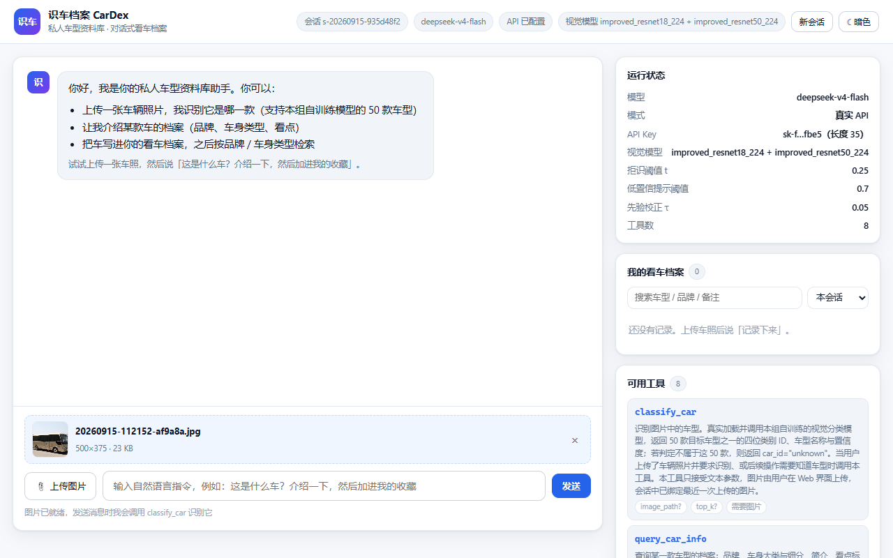
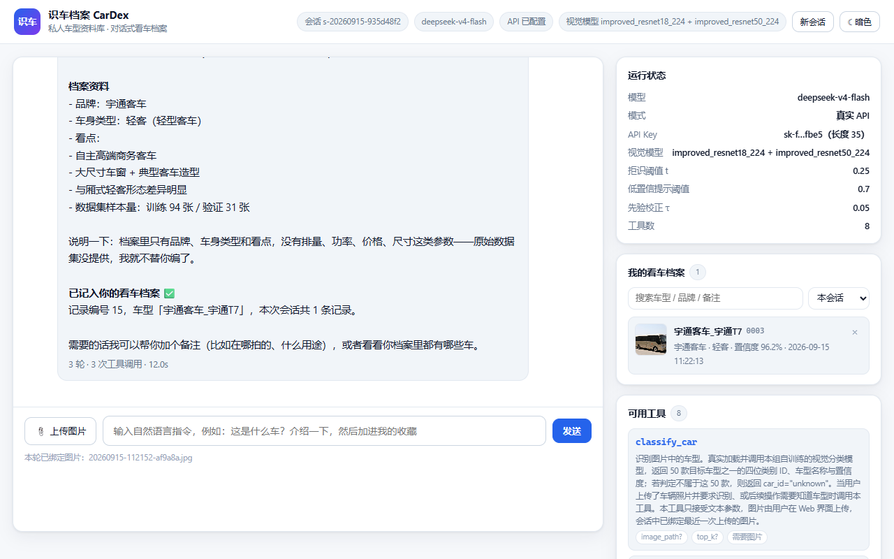
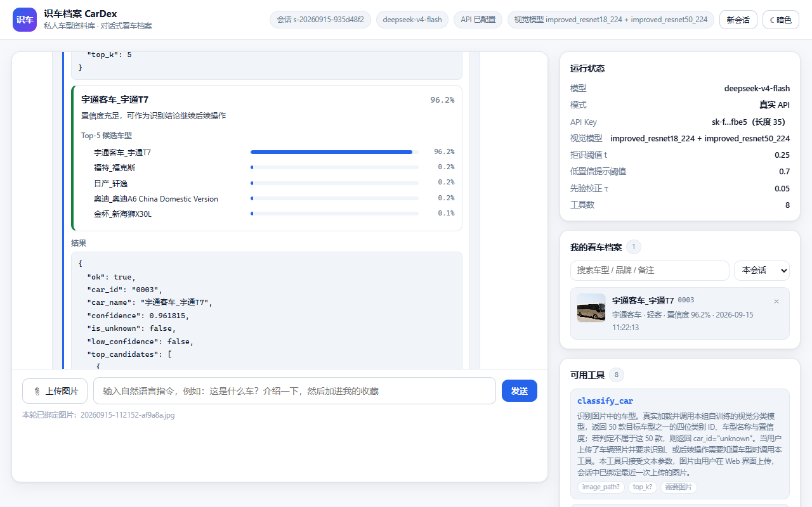
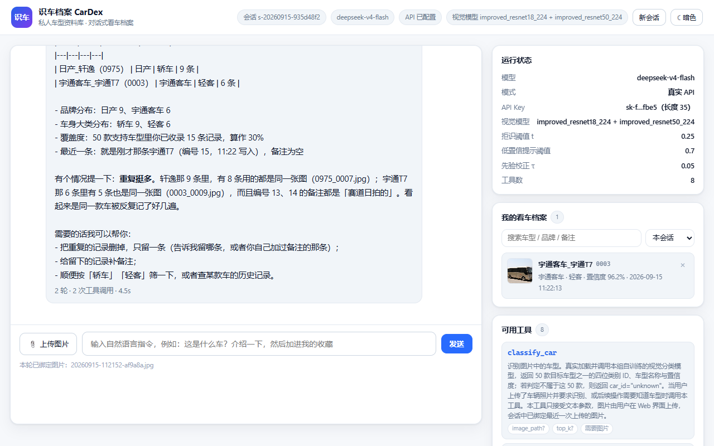
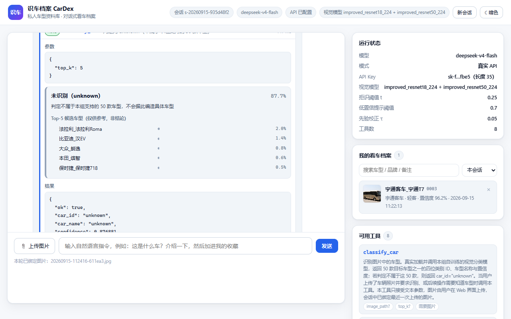
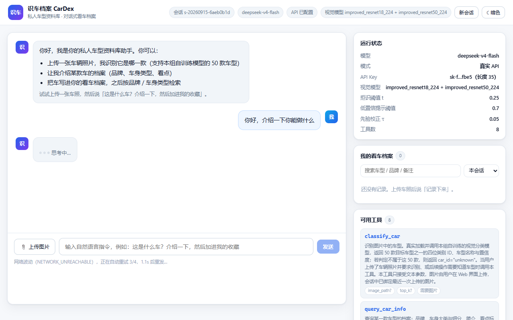
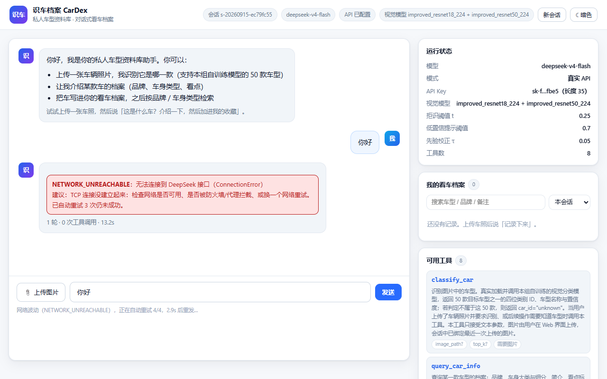

# 10 · 真实 API 与端到端测试报告

> 本文记录 **接入真实 DeepSeek API 之后**的全链路测试：环境自检 → 工具层 → 模型层 → Web 端到端 → 异常路径。
> 所有结论都来自本机实测，命令可原样复现。
>
> **合规声明**：本报告、本文档、以及仓库中任何 `.py / .md / .html / 截图` **均不含真实 API Key**。
> Key 只存在于两个地方：环境变量 `DEEPSEEK_API_KEY`，或 `agent/.env.local`（已被 `.gitignore` 忽略，不随作业提交）。
> 文档与界面中一律显示掩码，形如 `sk-f…fbe5（长度 35）`。

---

## 1. 结论摘要

| 测试层 | 脚本 | 结果 | 说明 |
|---|---|---|---|
| L0 环境自检 | `tools/selfcheck.py --all` | **37 / 37 通过** | 依赖、交付文件、模型权重、API 连通性、真实视觉推理 |
| L1 工具层 | `tools/e2e_test.py --stage A` | **20 / 20 通过** | 不走模型，逐个验证参数校验 / 门禁 / 错误码 / 拒识分支 |
| L2 模型层 | `tools/e2e_test.py --stage B` | **33 / 33 通过** | 真实 DeepSeek API，8 个对话场景、共 13 轮 |
| L3 Web 端到端 | 浏览器实测 | **通过** | 上传 → 对话 → 三工具链 → 档案落库 → 拒识，含截图 |
| L4 提交前自查 | `src/verify_submission.py` | **41 / 41 通过** | 任务一交付物合规 |
| L4 提交前自查 | `tools/verify_agent.py` | **59 / 59 通过** | 任务书第五、六节逐条 |

**合计 190 项检查全部通过**，并且在测试过程中**发现并修复了 5 个真实代码缺陷 + 4 个工程环境坑**（见第 8 节）——
这正是"接入真实 Key 之后再跑一遍"的价值：离线替身跑通不代表真实链路没问题。
其中第 8 个缺陷（瞬时网络故障直接判死）是**实机使用中真实触发**后排查修掉的，
第 9 个（超长工具结果截断成非法 JSON）是回归时**间歇性失败**顺藤摸瓜挖出来的——
数据越用越多才会踩到，属于"上线一段时间后必然爆发"的那类缺陷。

---

## 2. 测试环境

| 项目 | 实测值 |
|---|---|
| 操作系统 | Windows（`C:\WINDOWS`，内核 26100） |
| Shell | Windows PowerShell **5.1**（Desktop 版；本机**未安装** PowerShell 7，脚本已按 5.1 兼容编写） |
| Python | 3.13.5（Anaconda，`C:\ProgramData\anaconda3\python.exe`） |
| PyTorch | 2.13.0+cpu（CUDA 不可用，全程 CPU 推理） |
| torchvision | 0.28.0 |
| Flask / requests / Pillow / NumPy | 3.1.0 / 2.32.3 / 11.1.0 / 2.1.3 |
| 推理线程 | 8（PyTorch 默认） |
| 接口 | `https://api.deepseek.com/chat/completions` |
| 模型名 | `deepseek-v4-flash`（任务书规定，代码中为常量 `MODEL_NAME`） |
| 视觉模型 | `improved_resnet18_224` + `improved_resnet50_224` 集成，TTA 水平翻转，τ=0.05，t=0.25 |
| 端口 | 5000 |

### 2.1 关于接口返回的一个实测发现

`deepseek-v4-flash` 在本机表现为**带思维链的模型**：响应里除 `message.content` 外还有 `message.reasoning_content`，
且 `usage.completion_tokens` **包含思维链 token**。实测一次"只回复两个字"的请求消耗 133~218 token。

对本项目的影响：

* `agent/llm.py` 只取 `message.content` 与 `message.tool_calls`，多出来的 `reasoning_content` 被自然忽略，**无需改动**；
* 但 `max_tokens: 2048` 是**总预算**，思维链会占用一部分。若把 `max_tokens` 调到很小（如 20），
  会出现 `finish_reason=length` 且 `content` 为空——本项目已把这种情况翻译成明确的错误码
  `API_RESPONSE_INVALID`「输出被 max_tokens 截断」，而不是让空回复静默通过。

---

## 3. 一键启动

### 3.1 交付的启动文件

| 文件 | 作用 |
|---|---|
| `start.bat` | **双击入口**。自动挑 PowerShell（`pwsh` → `Program Files\PowerShell\7` → `WindowsApps` → 系统自带 5.1），转调 `start.ps1` |
| `start.ps1` | 真正的启动脚本：找 Python → 确认 Key → 环境自检 → 起服务 |
| `tools/selfcheck.py` | 启动前的环境自检，也可单独运行 |

> `start.ps1` 必须以 **UTF-8 with BOM** 保存。Windows PowerShell 5.1 读取无 BOM 的 `.ps1` 时会按系统 ANSI（本机 GBK）解码，
> 中文字符串会变成乱码并直接导致语法错误。这是实测踩到的坑，见第 8 节 BUG-4。

### 3.2 启动流程

```
  双击 start.bat
        │
        ├─ 1. 找 Python：.venv → Anaconda → PATH，并优先选「已装 torch+flask」的那个
        ├─ 2. 确认 API Key：环境变量 DEEPSEEK_API_KEY ＞ agent/.env.local
        │      都没有 → 当场提示粘贴一次，写进 agent/.env.local（已 gitignore）
        │      直接回车 → 离线替身模式（页面顶部会有醒目提示）
        ├─ 3. 环境自检：依赖 / 交付文件 / 权重 / 工具装配，有 FAIL 就中止并给出修复建议
        │      -DeepCheck 额外做「真实 API 调用 + 真实视觉推理」两项实测
        ├─ 4. 选端口：5000 被占用则自动顺延到 5001…（最多试 20 个）
        └─ 5. 拉起 web/app.py，打印访问地址，并延迟 3 秒自动打开浏览器
```

### 3.3 参数

| 参数 | 默认 | 说明 |
|---|---|---|
| `-Mode web\|cli\|check` | `web` | 启动 Web 系统 / 命令行智能体 / 只自检 |
| `-Port <n>` | `5000` | Web 端口，被占用自动顺延 |
| `-BindHost <ip>` | `127.0.0.1` | 只监听本机；要局域网访问可传 `0.0.0.0` |
| `-Offline` | 关 | 强制离线替身（即使已配 Key） |
| `-DeepCheck` | 关 | 自检时额外跑真实 API 与真实视觉推理 |
| `-NoCheck` | 关 | 跳过自检，直接启动 |
| `-NoBrowser` | 关 | 不自动开浏览器 |
| `-Install` | 关 | 启动前执行 `pip install -r requirements.txt` |
| `-Image <路径>` | — | `cli` 模式：先绑定一张图片 |
| `-Question <文本>` | — | `cli` 模式：只问一次就退出 |

常用组合：

```powershell
.\start.ps1                          # 起 Web（最常用，等价于双击 start.bat）
.\start.ps1 -Mode check -DeepCheck   # 只做全量自检（含真实 API + 视觉推理实测）
.\start.ps1 -Mode cli                # 命令行对话调试
.\start.ps1 -Port 8000 -NoBrowser    # 换端口、不开浏览器
.\start.ps1 -Install                 # 缺依赖时先装依赖
.\start.ps1 -Offline                 # 无网/无 Key 时演示（页面会标注「离线替身」）
```

---

## 4. L0 —— 环境自检（`tools/selfcheck.py`）

```
python tools/selfcheck.py            # 快检（不联网）
python tools/selfcheck.py --api      # 加做真实 API 连通性
python tools/selfcheck.py --vision   # 加做真实视觉推理
python tools/selfcheck.py --all      # 全量
python tools/selfcheck.py --json     # JSON 输出（供脚本解析）
```

实测输出（节选，`--all`，**37 项全过**）：

```
【依赖】        torch 2.13.0 (CUDA 可用: False)、torchvision 0.28.0、flask 3.1.0、
               requests 2.32.3、PIL 11.1.0、numpy 2.1.3
【API Key】    来源：agent/.env.local · sk-f…fbe5（长度 35）
               密钥文件已在 .gitignore 中 → 不会随作业提交
               接口模型名 deepseek-v4-flash
【交付文件】    classes.txt 250 B · predictions.csv 71,844 B
               classes.txt 校验通过：50 行 · 4 位数字 · 升序 · 无 BOM · 不含 unknown
               predictions.csv 表头正确：2422 行数据
【视觉模型】    improved_resnet18_224/best.pt 42.8 MB + improved_resnet50_224/best.pt 90.4 MB
【运行时】      torch 线程数 8 · 目录可写 · 端口 5000 空闲 · 磁盘剩余 494.5 GB
【智能体装配】  工具 8 个；视觉工具 1 个；非视觉工具 7 个（满足「≥1 + ≥2」）
【API 连通性】  HTTP 200 · 模型 deepseek-flash · 1020 ms · tokens 133 · 回复 '在线'
【视觉推理实测】0003_0009.jpg → 宇通客车_宇通T7 (96.18%, unknown=False) · 170 ms
               模型常驻复用：第二次调用 154 ms
```

`selfcheck.py` 不只是"跑一下 import"，它把任务书的硬性约束也编成了断言：
`classes.txt` 的行数/位数/升序/BOM/不含 unknown、`predictions.csv` 的表头、集成权重是否齐全、工具数量是否达标。

---

## 5. L1 —— 工具层（`tools/e2e_test.py --stage A`）

**不经过模型**，直接调 `ToolRegistry.execute`，因此结果确定、毫秒级（总计 6.8 s，其中 6.4 s 是首次加载视觉模型）。

| # | 检查项 | 预期 | 实测 |
|---|---|---|---|
| A1 | 识别支持车型 | 成功 + 具体车型 + Top-5 + 结构化建议 | 宇通客车_宇通T7 96.18%，`decision.action=accept` |
| A2 | 识别范围外车型 | `is_unknown=True` + `report_unknown` | car_id=unknown，conf=87.69% |
| A3 | 未上传图片就调用 | 前置门禁拒绝 | `DENIED_BY_POLICY` |
| A4 | 图片路径不存在 | 如实报错 | `IMAGE_NOT_FOUND` |
| A5 | `top_k=999` 越界 | Schema 拦截 | `INVALID_ARGUMENTS`「$.top_k: 不能大于 10」 |
| A6 | 传多余参数 | `additionalProperties:false` 拦截 | `INVALID_ARGUMENTS` |
| A7 | 参数不是合法 JSON | 解析失败报错 | `INVALID_ARGUMENTS` |
| A8 | 调用未注册工具 | 报错并列出可用工具 | `UNKNOWN_TOOL` |
| A9 | 查询范围外车型 `0022` | 拒绝，不编造资料 | `CAR_NOT_FOUND` |
| A10 | 没有识别结果就写档案 | 拒绝 | `DEPENDENCY_MISSING` |
| A11 | 按车身类型筛选清单 | SUV 恰好 21 款 | 返回 21 款 |
| A12 | 把 unknown 写进档案 | 拒绝（会话状态路径） | `UNKNOWN_CAR` |
| A12b | 显式传 `car_id="unknown"` | 拒绝（显式参数路径） | `UNKNOWN_CAR` |
| A13 | 低置信度分支 | `confirm_with_user`（把显示阈值临时抬到 1.01 构造） | 命中，指引文本正确 |
| A14 | 工具调用记录落盘 | `agent/data/tool_calls.jsonl` 存在且字段完整 | 实测 186 行 |

**这一层的意义**：任务书 5.5「低置信度 / unknown / 异常情况处理」如果只靠大模型自由发挥，
是无法验证的。这里把它下沉成**确定性的工具行为**——工具结果里直接带 `decision.action`
（`accept` / `confirm_with_user` / `report_unknown`）和对应的中文指引，模型只要照着走就行。

---

## 6. L2 —— 模型层（`tools/e2e_test.py --stage B`）

真实调用 DeepSeek API，8 个场景、13 轮对话，**总计 37.9 秒**（33 / 33 全过）。

### 6.1 场景总表

| 场景 | 用户输入 | 本轮工具 | 轮次 | 耗时 |
|---|---|---|---|---|
| S1 纯文本问候 | 你好，介绍一下你能做什么 | —（0 次） | 1 | 3.4 s |
| S2 上传图后识别 | 这是什么车？ | `classify_car` → `query_car_info` | 3 | 10.2 s（含首次加载视觉模型 6.8 s） |
| S3 **单轮 3 工具串联** | 识别…查资料…加进收藏 | `classify_car` → `query_car_info` → `add_car_record` | 4 | 5.4 s |
| S4 多轮同会话 | ①这是什么车 ②它是什么品牌/车身类型 ③加进档案，备注"赛道日拍的" | ①2 次 ②**0 次** ③`add_car_record` | 3+1+2 | 3.9+2.2+3.2 s |
| S5 范围外车型 | 这张照片里是什么车？帮我记录一下 | 仅 `classify_car`（拒识后不写档案） | 2 | 3.3 s |
| S6 无图要求识别 | 帮我识别一下我刚拍的车 | `classify_car` → 被门禁拒绝 | 2 | 2.5 s |
| S7 档案检索统计 | 我的看车档案里都有什么？按品牌汇总 | `my_garage_stats` → `search_my_records` | 2 | 3.7 s |
| S8 范围外提问 | 你能识别奔驰S级和宝马3系吗 | `list_supported_cars` ×2 | 2 | 2.8 s |

### 6.2 关键验证点

**① 视觉识别确实由模型自己发起（不是外部预先算好塞进提示词）**

S2 的事件流里，`classify_car` 出现在模型的 `tool_calls` 中：

```
你 > 我上传了一张车的照片，这是什么车？
  ↳ classify_car({"top_k": 5})
    [OK] classify_car 6825ms  宇通客车_宇通T7 · 0003 · 96.2%
  ↳ query_car_info({"car_id_or_name": "0003"})
    [OK] query_car_info 2ms  宇通客车_宇通T7｜宇通客车｜轻客
```

这正是任务书 5.1 要考察的点：图片不是"后台先算好、把结论拼进 Prompt"，而是模型在循环里自主决定调用工具，
工具**真实加载 checkpoint 并前向推理**（首次 6.8 s 是模型加载，之后同图 141~170 ms）。

**② 单轮内 ≥3 个工具串联（任务书 5.3 硬性要求）**

S3 一轮内完成 `classify_car → query_car_info → add_car_record`，三个工具全部 `ok`，
并返回档案记录号（实测 `#19`），证明写库真的发生了。

**③ 多轮会话沿用上文（任务书 5.4）**

S4 第 2 轮**没有重新上传图片**，本轮工具列表为空 `[]`——模型直接沿用会话里第 1 轮的视觉结果作答：

```
你 > 它是什么品牌、什么车身类型？给我讲讲。
助手 > **品牌：宇通客车**（国产商用车品牌，主要做客车/大巴）
       **车身类型：轻客 —— 轻型客车**
```

第 3 轮说"加进我的档案，备注写赛道日拍的"，模型省略 `car_id` 直接调 `add_car_record`，
工具回退到 `session.last_prediction`，记录写入且 `note='赛道日拍的'`。

**④ 拒识处理（任务书 5.5）**

S5 用一张**不在 50 类里**的图（`data/val/unknown/0022_0022.jpg`）：

```
结论：这张照片我认不出来——未识别为本组支持的车型
（模型判定它不属于我能识别的 50 款车，置信度 0.877，属于明确拒识，不是「差一点认出来」）。
...
| 候选 | 相似度 |
| 法拉利 Roma | 0.020 |   ← 5 个候选全部列出，且明确标注"不是结论"
| 比亚迪 汉EV  | 0.014 |
...
这些分数都很低，等于没有指向性，所以我不给你编一个车型，也不会把它写进档案。
```

断言全部命中：`is_unknown=True`、本轮**没有**调用 `add_car_record`、回复里明确说明未识别。

**⑤ 无图片时的异常反馈（任务书 5.5）**

S6 在没有图片的会话里要求识别，模型仍然发起 `classify_car` 调用，
被注册表的前置门禁拦下（`DENIED_BY_POLICY`），失败原因如实回传给模型，模型据此转述给用户：

```
我这边还没收到图片，所以暂时没法识别。麻烦你在界面里上传一张车辆照片，我再帮你认。
拍的时候注意：正侧面或斜前方 45°、车身完整入镜、光线充足……
```

**智能体没有崩**，也没有编造一个结果。

### 6.3 模型自发表现出的"好行为"（未在提示词中要求）

* S7 汇总档案时，模型自己发现"15 条记录只覆盖 2 款车、重复很多"，主动指出
  `0975_0007.jpg` 被反复写入，并提议清理重复；
* S5 拒识时主动说明"你这张（20260915-112416）和之前那张宇通T7 不是同一张图，所以你档案里那条记录没受影响"；
* S8 被问"能不能识别奔驰S级"时，先查清单再回答，并补充"同品牌的 E 级/5 系外观接近，拍到这两款把握更大"。

---

## 7. L3 —— Web 系统端到端（浏览器实测）

用真实浏览器访问 `http://127.0.0.1:5000/`，走完整交互路径。

### 7.1 实测步骤

| 步骤 | 操作 | 结果 |
|---|---|---|
| 1 | 打开页面 | 顶栏显示会话号、`deepseek-v4-flash`、**API 已配置**、视觉模型两个；右栏"运行状态"显示 t=0.25 / 显示阈值 0.7 / τ=0.05 / 工具数 8 |
| 2 | 上传一张车辆照片 | 预览出现，提示"图片已就绪，发送消息时我会调用 classify_car 识别它" |
| 3 | 发送"这是什么车？介绍一下，然后加进我的收藏" | **3 轮 · 3 次工具调用 · 12.0 s**；工具时间线依次出现 `classify_car` / `query_car_info` / `add_car_record`，三张卡片都是"成功" |
| 4 | 查看视觉结果卡片 | 宇通客车_宇通T7 · **96.2%** · "置信度充足" · Top-5 候选条形图 |
| 5 | 查看右栏档案面板 | 立即出现 1 条记录：`宇通客车_宇通T7 0003 · 宇通客车 · 轻客 · 置信度 96.2%` |
| 6 | 再发"我的看车档案里都有什么？" | 同一会话第 2 轮，**2 轮 · 2 次工具 · 4.5 s**，模型给出品牌分布与覆盖率统计（15 条记录 / 覆盖 30%） |
| 7 | 换一张**范围外**的车图再问 | `classify_car` 卡片变为灰色 `report_unknown` 样式："未识别（unknown）87.7%"，列出 5 个真实候选车型并标注"仅供参考，非结论" |
| 8 | 确认档案面板 | **仍然是 1 条**——拒识结果没有被写入档案（符合任务书 5.5） |

截图见 `docs/images/`（下方直接内嵌）：

**1) 上传后页面状态** —— 顶栏显示会话号、模型、**API 已配置**、两个视觉模型；右栏是运行状态与档案面板。



**2) 三工具链完成** —— `3 轮 · 3 次工具调用 · 12.0s`，档案面板立即出现 `宇通客车_宇通T7 0003 · 轻客 · 置信度 96.2%`。



**3) 视觉结果卡片（本次新增）** —— 车型 + 96.2% + "置信度充足" + Top-5 候选条形图，下方保留原始 JSON。



**4) 同一会话第 2 轮** —— 未重新上传图片，模型基于会话状态给出品牌分布与覆盖率统计。



**5) 拒识分支** —— 灰色卡片："未识别（unknown）87.7%"，5 个真实候选车型全部标注"仅供参考，非结论"。



### 7.2 本次顺带做的一处界面改进

`classify_car` 的工具卡片原先只把结果 JSON 原样铺开（要展开才看得到，且要自己找 `top_candidates`）。
现在在 JSON 之上增加了一张**视觉结果卡片**：

* 车型 + 置信度大字；
* 一行结论（`置信度充足` / `置信度偏低，建议向用户确认` / `判定不属于本组支持的 50 款车型`）；
* Top-K 候选的横向条形图；
* 三种分支用不同的左侧色条区分：绿=接受、黄=需确认、灰=拒识。

这让任务书 5.5 要求的"低置信度 / unknown"处理在界面上**一眼可见**，而不只是藏在模型的行文里。

---

## 8. 本次发现并修复的缺陷

> 接入真实 Key 之前，这些缺陷都被离线替身"掩盖"着——因为替身只走固定分支，既不读 `top_candidates`，
> 也不会遇到网络故障。

**代码缺陷 5 个**：BUG-1（集成丢失 Top-K）、BUG-2（Top-K 混入 unknown）、
BUG-3（骨架自查被真实模型污染）、BUG-8（瞬时网络故障直接判死 + 报错不可读）、
BUG-9（超长工具结果截断成非法 JSON，整轮对话崩掉）。

**工程环境坑 4 个**：BUG-4（PS 5.1 读无 BOM 的 `.ps1` 变乱码）、BUG-5（`ErrorActionPreference='Stop'` 被 stderr 打断）、
BUG-6（PS 5.1 吃掉单引号串里的双引号）、BUG-7（`web/app.py` 缺 `--offline`）。

**一个共同规律**：这 5 个代码缺陷里，**4 个都只在"真实使用一段时间、状态变多"之后才会出现**
（档案记录累积 → 结果变长 → 触发 BUG-9；网络波动 → 触发 BUG-8；换图片/换会话 → 触发 BUG-1）。
离线替身永远走固定的短路径，所以一个都发现不了。

### BUG-1（严重）集成推理丢掉了 Top-K 候选

**现象**：`CarEnsemble.predict_path(path, top_k=5)` 收下了 `top_k` 参数却**从未使用**，
返回体里没有 `top_candidates`，导致 `classify_car` 的 `top_candidates` 恒为 `[]`。

**影响**：任务一最终交付的就是 **C1+C2 集成**，也就是说**交付配置下**，
任务书 5.5 要求的"低置信度时展示 Top-K 让用户确认"完全没有数据可用。

**定位**：`src/cardex/inference.py` —— `CarEnsemble.predict_batch()` 只返回
`label_id / label_name / index / confidence / is_unknown`，而 `predict_path()` 直接透传它的结果。
（单模型 `CarClassifier.predict_image()` 是返回 `top_k` 的，所以问题只在集成路径上。）

**修复**：给 `predict_batch()` 增加可选参数 `top_k`，对**校正后的集成概率**排序并附上候选列表；
`predict_path()` 透传。因为参数可选，`src/finalize.py`、`src/evaluate.py` 等既有调用**行为完全不变**
（`predictions.csv` 与 0.9604 的 Macro-F1 不受影响）。

**验证**：A1b 由 FAIL 转 PASS，S5 场景下模型能列出 5 个真实候选。

### BUG-2 Top-K 里混进了 `unknown` 这一行

**现象**：修复 BUG-1 后，候选列表第 1 名是 `unknown`（因为它的概率最高，如 87.7%）。

**影响**：`unknown` 不是"候选车型"，它是"以上都不是"这个**结论本身**。
把它列进"最相似的几款车"，语义上是错的。

**修复**：`agent/tools/vision.py` 向分类器多要一个候选（`top_k + 1`），
过滤掉 `car_id == "unknown"` 后再截取 `top_k`，保证返回给模型的永远是 K 个**真实车型**。

### BUG-3（测试可信度）`verify_agent.py` 在有 Key 时会静默切换成真实模型

**现象**：接入 Key 后重跑 `tools/verify_agent.py`，由 **59/59** 变成 **57/59**。

**根因**：该脚本调用 `load_config()`，而 `load_config` 在"有 Key"时会自动选 `DeepSeekClient`。
于是这套**本该可复现**的骨架自查，悄悄变成了"真实模型行为测试"，
两条依赖具体措辞/固定工具序列的断言随之失败。

**修复**：`verify_agent.py` 默认强制 `cfg.offline = True`（并在输出里打印当前模式），
新增 `--live` 才切到真实模型；同时把两条断言改得更严谨——
"回复说明了未识别"改为接受同义表述，多轮写档案那条在 `--live` 下如实降级为 WARN 并说明原因。

**分工因此更清晰**：

| 脚本 | 管什么 | 是否可复现 |
|---|---|---|
| `tools/verify_agent.py` | 智能体**骨架**（工具注册、门禁、会话、错误码、Web 路由） | 是（离线替身） |
| `tools/e2e_test.py` | **真实模型**行为（工具链、多轮、拒识话术） | 否（模型有随机性，但 13 轮全部符合预期） |

### BUG-4（工程环境）PowerShell 5.1 会把无 BOM 的 `.ps1` 读成乱码

**现象**：`start.ps1` 报一堆语法错误，报错里中文全是 `鐪熷疄` 这样的乱码。

**根因**：Windows PowerShell 5.1 对**没有 BOM** 的 `.ps1` 按系统 ANSI 代码页（本机 GBK）解码。
文件是 UTF-8，于是每个中文字符串都变成了乱码，连引号配对都被破坏。

**修复**：`start.ps1` 以 **UTF-8 with BOM** 保存（`start.bat` 内容全为 ASCII，不受影响）。

### BUG-5（工程环境）`$ErrorActionPreference='Stop'` 会被 Python 的 stderr 打断

**现象**：启动脚本在 `python -c ...` 之后直接终止。

**根因**：PowerShell 5.1 把外部程序写到 stderr 的每一行都包装成 `NativeCommandError` 错误记录，
在 `Stop` 语义下会变成终止性错误。

**修复**：脚本统一用 `Continue`，关键步骤显式判断 `$LASTEXITCODE` / 显式 `-ErrorAction Stop`，
并在代码里写明了原因，避免后人"顺手改回去"。

### BUG-6（工程环境）PS 5.1 传参给外部程序会吃掉单引号串里的双引号

**现象**：`python -c 'import sys;print("%d.%d.%d"%sys.version_info[:3])'` 送到 Python 变成
`print(%d.%d.%d%sys.version_info[:3])`，报 `SyntaxError`（实测复现）。

**根因**：PS 5.1 在拼装外部程序命令行时对参数重新加引号，单引号串内部的 `"` 被吞掉。

**修复**：传给外部程序的 Python 代码统一写成「PowerShell 双引号 + Python 单引号」。

### BUG-8（严重，实机触发）瞬时网络故障直接判死，且报错无法阅读

**现象**：实机使用中出现

```
API_REQUEST_FAILED：调用 DeepSeek 接口失败：ConnectionError: HTTPSConnectionPool(
host='api.deepseek.com', port=443): Max retries exceeded with url: /chat/completions
(Caused by NameResolutionError(...: Failed to resolve 'api.deepseek.com'
([Errno 11001] getaddrinfo failed)))
```

**排查结论**：这是**一次瞬时 DNS 解析失败**，不是配置或代码问题。
复查时 DNS 已恢复（Python `getaddrinfo` 13 ms、`nslookup` 正常），
连续 3 次真实 API 调用全部成功（2.0 s / 1.8 s / 2.0 s）。

**但它暴露了两个真实缺陷**：

1. **零重试**。DNS 抖动通常一两秒就自愈，而项目是"一次失败 = 整轮失败"——
   用户得把自己刚打的那句话重新打一遍。对比主流 agent harness，网络类瞬时故障都会退避重试。
2. **报错不可读**。把 urllib3 的异常字符串原样抛出，用户看到的是 `HTTPSConnectionPool`、
   `Max retries exceeded`、`NameResolutionError` 这一串——既看不出坏在哪一层，也看不出该怎么办。

**修复**：把"发请求"和"重试策略"拆开（`agent/llm.py`）：

* 新增 `classify_request_error()`：按网络栈**自下而上分层**判定，翻译成带修复建议的错误码 ——

  | 错误码 | 触发条件 | 是否重试 |
  |---|---|---|
  | `NETWORK_DNS_FAILED` | `NameResolutionError` / `getaddrinfo failed` / `[Errno 11001]` | ✅ |
  | `NETWORK_UNREACHABLE` | 其他连接失败、代理失败 | ✅ |
  | `NETWORK_TLS_FAILED` | `SSLError` / 证书校验失败 | ❌（配置问题，重试无意义） |
  | `API_TIMEOUT` | 连接或读取超时 | ✅ |
  | `API_RATE_LIMITED` / `API_SERVER_ERROR` | HTTP 429 / 5xx | ✅ |
  | `API_REQUEST_FAILED` | HTTP 400 / 401 / 402 / 403 | ❌（**快速失败**，附明确建议） |

* `complete()` 只在 `retryable` 时做**指数退避 + ±25% 抖动**重试
  （默认 `max_retries=3`、`retry_backoff=0.8` → 约 0.8 s / 1.6 s / 3.2 s）；
* 重试过程通过 `notify` 回调广播 `api_retry` / `api_recovered` 事件，
  Web 前端实时显示"网络波动（NETWORK_DNS_FAILED），正在自动重试 2/4，1.6s 后重发…"，
  用户知道系统在自救，而不是界面卡死；
* 网络类错误失败后，前端把用户刚才那句话**放回输入框**，直接再点一次发送即可。

**实测验证**（构造四类故障）：

| 用例 | 构造 | 结果 |
|---|---|---|
| E-A 域名解析失败 | 指向不存在的域名 | `NETWORK_DNS_FAILED`，`retryable=True`，实际尝试 3 次，广播 2 次 `api_retry`，提示指向 DNS 而非代码 |
| E-B 连不上的 IP | 指向非路由地址 `10.255.255.1` | `API_TIMEOUT`（ConnectTimeout），重试 2 次，4.2 s 后失败 |
| E-C Key 无效 | 假 Key | `API_REQUEST_FAILED`，`retryable=False`，**0.1 s 快速失败，零重试** |
| E-D 正常调用 | — | `retries=0`，1.3 s |
| E-E 重试后成功 | 前 2 次强制失败、第 3 次放行 | 第 3 次成功，`retries=2`，事件序列 `api_retry, api_retry, api_recovered` |

**浏览器端实测**：另起一个实例把 `api_url` 指向 `https://127.0.0.1:9`（必然连接失败），在真实浏览器里发消息：

* 输入框下方实时显示 `网络波动（NETWORK_UNREACHABLE），正在自动重试 3/4，1.1s 后重发…`；
  
* 重试耗尽后给出完整错误卡片——**错误码 + 原因 + 建议 + 「已自动重试 3 次仍未成功」**，
  并且**把用户刚打的那句话放回输入框**，直接再点一次发送即可；
  临时重试提示在收尾时被清除，不会一直挂在界面上。
  

**修复过程中又挖出一个连带缺陷**：`TurnResult.to_dict()` 只带了 `error.code` 和 `error.message`，
**把 `info`（含 `hint` 修复建议）丢掉了**。于是 SSE 的 `error` 事件虽然带了建议，
但随后 `result` 事件会用 `to_dict()` 的内容**覆盖**界面，导致用户最终只看到一句
"无法连接到 DeepSeek 接口"，看不到该怎么处理——正是本次问题的原始症状。
已给 `TurnResult` 增加 `error_info` 字段并贯通到前端。

**顺带发现**：诊断脚本第一版只测解析结果的**第一个 IP**，报了假 FAIL。
逐个测才发现 `api.deepseek.com` 的三个 A 记录里
`112.48.148.243` **稳定不通**（连续两次 5 s 超时），另两个 6~8 ms 正常。
已改为**逐个 IP 实测并分级报告**（全通=OK、部分不通=WARN 并说明不影响使用、全不通=FAIL）。
实测 8 次真实请求延迟 896~1836 ms、零重试——因为该 IP 在解析结果里始终排最后，
请求直接命中可达节点。这条信息现在会出现在 `selfcheck.py --net` 里。

### BUG-9（严重，真实模型下约 1/8 概率触发）超长工具结果被截断成非法 JSON，整轮对话崩掉

**发现过程**：全量回归时 `e2e_test.py` 的 S7 场景突然从通过变成

```
[FAIL] S7 档案汇总轮次成功
[FAIL] S7b 基于真实档案数据给出汇总        0 字
[OK]   S7a 调用了档案类工具
```

**特点**：工具有明确返回（`my_garage_stats 共 33 条记录`），但整轮 `ok=False`、回复 0 字。
而且**时好时坏**——单跑 4 次挂 1 次，典型的"和输入长度有关"的间歇性缺陷。

**定位**：加 `traceback` 直接调 `_run_steps` 绕开 `run_turn` 的兜底 try，复现出完整调用栈：

```
File "agent/loop.py", line 323, in _run_steps
    session.add_tool_result(call.id, call.name,
        truncate(res.content(), MAX_TOOL_RESULT_CHARS), ...)
File "agent/session.py", line 97, in add_tool_result
    "result": json.loads(content) if content and content.lstrip().startswith("{") else content,
json.decoder.JSONDecodeError: Invalid control character at: line 1 column 3001 (char 3000)
```

**根因**：两处各自都有问题，凑在一起就炸。

1. `loop.truncate()` 是**纯文本**截断：`text[:3000] + "\n…（已截断）…\n" + text[-3000:]`。
   对一个 JSON 字符串这么切，切出来的当然**不再是合法 JSON**——
   插入的那段说明文字带着裸换行，正好落在某个未闭合的字符串里。
2. `session.add_tool_result()` 看到内容以 `{` 开头就无条件 `json.loads()`，
   把这个解析失败**直接抛了出去**。而事件日志里的 `result` 字段只是**审计/展示用的副本**，
   它解析失败**不应该**有能力打断一轮真实对话。

**触发条件**：工具结果超过 `MAX_TOOL_RESULT_CHARS = 6000` 字符。
`my_garage_stats(scope=all)` 在档案积累到 33 条记录时正好越线——数据越多越容易踩。
（本项目档案记录是累积的，所以这是个"用久了必然出现"的缺陷。）

**修复（两层）**：

* **治本** —— 新增 `loop.truncate_tool_result()`：**结构化裁剪**。
  先 `json.loads`，再按 `(字符串上限, 列表保留项数)` 的档位逐级瘦身
  （`(2000,50) → (500,20) → (200,8) → (80,3) → (40,1) → (20,0)`），
  一装得下就停手，最后重新序列化。**保证输出的永远是合法 JSON。**
  裁剪后在结果里显式加 `_truncated: true` / `_original_chars` / `_notice`，
  让模型知道"这份数据不完整、需要精确参数就重调"，而不是把残缺数据当成全部事实。
  非 JSON 内容（理论上不该有）退回文本截断。`truncate()` 保留但明确标注**只用于纯文本**。
* **兜底** —— `session._parse_for_log()`：解析失败就原样存字符串，绝不外抛。

**实测**：

| 用例 | 修复前 | 修复后 |
|---|---|---|
| 6614 字符的 `my_garage_stats` 结果 | ✗ `JSONDecodeError: Invalid control character at char 3000` | ✓ 合法 JSON，4168 字符；保留 `ok` / `total_records` / 20 条记录 / 全部品牌 + 裁剪标记 |
| 长度边界 10 / 100 / 1000 / 5999 / 6000 / 6001 / 20000 / 200000 | — | ✓ 全部为合法 JSON，且均未超限 |
| 非 JSON（纯文本 / 空 / 数组） | — | ✓ 不抛异常 |
| `_parse_for_log` 收到非法 JSON | ✗ 抛出 | ✓ 原样返回字符串 |
| **原失败场景压测（3 种问法 × 4 次）** | 约 1/8 崩 | **12/12 全部成功**，回复 360~1537 字 |

---

### BUG-7 `web/app.py` 缺少 `--offline`

**现象**：`start.ps1 -Offline` 无处可传，无法在已配置 Key 的机器上强制演示离线模式。

**修复**：`web/app.py` 增加 `--offline`，命中时按需重建模块级的 `CONFIG` / `AGENT`。

---

## 9. 异常路径测试

单独构造异常，验证错误被**如实上报**而不是被吞掉或伪装成功：

| 场景 | 构造方式 | 实测结果 |
|---|---|---|
| 无效 API Key | 用 `sk-000…` 假 Key 直连 | `API_REQUEST_FAILED` · HTTP 401 · 提示"API Key 无效或已失效" |
| 模型名不存在 | `model='no-such-model-xyz'` | `API_REQUEST_FAILED` · HTTP 400 · 提示"检查模型名、请求参数与消息顺序" |
| 未配置 Key 时强行走真实客户端 | `api_key=''` | `API_KEY_MISSING` · 并给出配置指引 |
| 未配置 Key 时自动降级 | 临时移走 `.env.local` | `offline=True`，客户端自动变成 `ScriptedClient`，掩码显示"(未配置)" |
| 图片无法解析 / 超 12 MB | Web 上传接口 | `IMAGE_UNREADABLE` / `FILE_TOO_LARGE`（前端也先拦一道） |
| 单条消息超 2000 字 | Web 对话接口 | `TOO_LONG` |
| 连续 3 次相同失败 | 循环内熔断 | 提前终止，避免模型原地打转耗尽预算 |

---

## 10. 复现步骤

```powershell
cd E:\Hanako\OH-WorkSpace\car-kb-agent

# 0) 确认 Key 已配置（密钥只写 .env.local / 环境变量，绝不进代码与报告）
python tools/selfcheck.py                     # 看到「API Key 来源：agent/.env.local」即可

# 1) 全量环境自检（依赖 + 交付文件 + 权重 + 真实 API + 真实视觉推理）
python tools/selfcheck.py --all

# 2) 工具层（确定性，约 7 秒）
python tools/e2e_test.py --stage A

# 3) 模型层（真实 API，约 40 秒，13 轮对话）
python tools/e2e_test.py --stage B

# 4) 只跑某一个场景
python tools/e2e_test.py --stage B --only S3,S5

# 5) 离线对照（无 Key / 断网时也能跑，结果不代表模型效果）
python tools/e2e_test.py --offline

# 6) 提交前自查
python src/verify_submission.py               # 任务一：41 项
python tools/verify_agent.py                  # 任务二三：59 项（离线骨架）
python tools/verify_agent.py --live           # 任务二三：切真实模型再跑一遍

# 7) 一键启动 Web
.\start.ps1
```

---

## 11. 尚未覆盖 / 已知限制

1. **教师测试集未提供**：仓库里的 `predictions.csv` 是在本地 `data/val`（2422 张，含 588 张 unknown）上的
   **演练结果**，Macro-F1 = 0.9604。拿到测试目录后执行
   `python src/predict_batch.py --input-dir <dir>` 重新生成即可，脚本与格式均无需改动。
2. **并发未压测**：Flask 以 `threaded=True` 运行，Agent 对同一会话加锁、不同会话可并发，
   但本次只测了单用户顺序交互。
3. **真实模型的措辞不保证逐字一致**：L2 的 33 项断言全部是对**行为**（调了哪些工具、成功与否、
   状态是否正确）的检查，只有极少数涉及措辞的断言做了同义放宽。多次运行结果可能个别措辞不同，
   但工具链与状态机不变。
4. **`reasoning_content` 未展示**：接口返回的思维链被有意忽略，没有写进会话日志，
   以免把模型内部推理与业务事实混在一起。
5. **超时参数按 CPU 环境调过**：视觉工具 `timeout_s=120`，模型 `read_timeout=90`。
   换到更慢的机器上首次加载模型可能需要放宽。

---

## 12. 结论

接入真实 API 后，任务二、任务三的全部链路——**环境 → 工具 → 模型 → Web → 异常**——
均已在真实条件下跑通并通过检查（L0~L4 合计 190 项）。

更重要的是，这次真实链路测试**暴露了 5 个仅靠离线自测发现不了的代码缺陷**
（最严重的一个会让任务书 5.5 的"低置信度展示 Top-K"在最终交付配置下无数据可用；
另外两个是实机使用中真实触发、导致整轮失败的瞬时网络故障处理，
以及数据累积后必然爆发的超长工具结果截断崩坏），它们都已被修复并纳入回归。

---

**相关文档**：[05 · 脚本与命令手册](05_脚本与命令手册.md) · [03 · 配置参数详解](03_配置参数详解.md) · [08 · 常见问题与排错](08_常见问题与排错.md) · [09 · 任务二三交接说明](09_任务二三交接说明.md)
