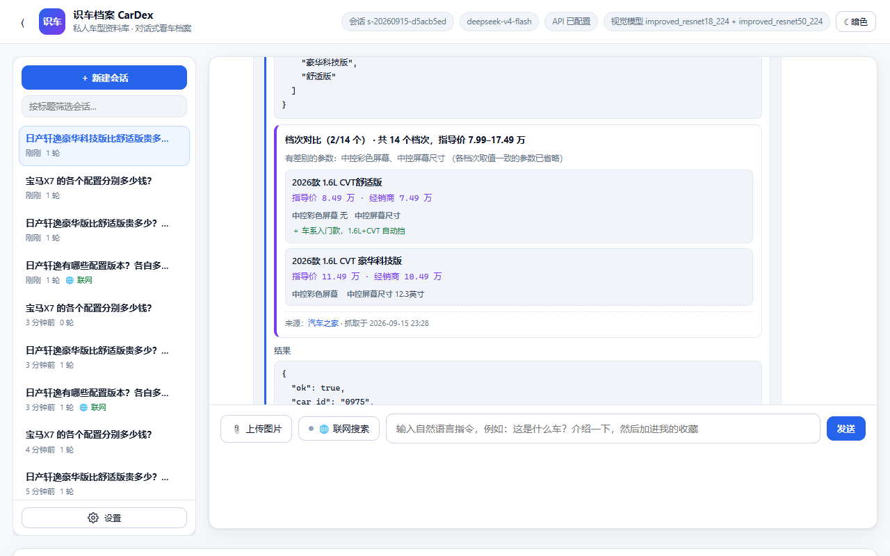

# 12 · 车型档次知识库（价格 / 参数 / 档次差异）

> 本文说明「**档案库支持车辆各档次（标准版、豪华版……）的价格与参数，以及档次之间的差别**」
> 和「**搜索到的信息可以存进档案**」这两件事是怎么做的。
>
> 核心难点只有一个：**数据从哪来，以及怎么保证不是编的。**

---

## 1. 为什么需要它

教师数据集只提供 **类别 ID + 车型名**。所以原始档案库里一款车只有：

```
品牌 · 车身大类 · 车身细分 · 一句话简介 · 看点标签 · 数据集样本量
```

**没有价格、没有配置、更没有"舒适版比豪华版差在哪"**。

而"看车"这件事，用户最关心的恰恰就是这些。于是本项目把档次信息做成一层
**可以不断积累的知识**：联网查到 → 存进档案库 → 以后直接查，不必再联网。

```
web_search 找报价/配置页
   → browse_page 打开（结构化抽取表格）
      → save_car_trims 存进档案库（必须带来源 URL）
         → query_car_info / compare_car_trims 直接回答
```

---

## 2. 数据模型

新增一个**独立文件** `agent/data/car_trims.json`：

```jsonc
{
  "schema": 1,
  "cars": {
    "0975": {
      "car_id": "0975",
      "car_name": "日产_轩逸",
      "brand": "日产",
      "body_group": "轿车",
      "trims": [
        {
          "trim_id": "t-3f9a1c2b7e",
          "name": "2026款 1.6L CVT 舒适版",
          "year": "2026",
          "guide_price_wan": 8.49,       // 厂商指导价（万元）
          "dealer_price_wan": 7.49,      // 经销商参考价
          "price_text": "7.49万起",       // 页面原话，保留以防换算有争议
          "specs": {                     // 有区分度的参数
            "发动机": "1.6L 135马力 L4（HR16）",
            "变速箱": "CVT无级变速",
            "中控彩色屏幕": "有",
            "中控屏幕尺寸": "8英寸"
          },
          "highlights": ["车系入门款，1.6L+CVT 自动挡"],
          "source": {
            "url": "https://car.autohome.com.cn/config/series/448.html",
            "site": "汽车之家",
            "fetched_at": "2026-09-15 23:28:41",
            "verified": true               // 这个 URL 真的在本会话用 browse_page 打开过
          }
        }
      ],
      "sources": [ /* 去重后的来源列表，最多保留 12 条 */ ],
      "notes":   [ /* 伴随数据一起记下的补充说明 */ ],
      "updated_at": "2026-09-15 23:28:41"
    }
  }
}
```

**为什么和 `car_profiles.json` 分开**：后者由 `tools/build_car_profiles.py`
从数据集**重新生成**，档次是运行时积累的知识，不能被重新生成覆盖掉。

---

## 3. 反编造：三道防线

价格是**最容易被大模型顺手编一个**的东西（而且编得还挺像）。这个项目的底线是
"查不到就说查不到"，所以：

| 防线 | 做法 | 效果 |
| --- | --- | --- |
| ① 来源必填 | `source_url` 是**必填参数**，不合法直接 `INVALID_ARGUMENTS` | 没有来源的数据根本进不了库 |
| ② 来源核验 | 扫描本会话事件日志，检查该 URL 是否**真的用 `browse_page` 打开过** | 模型不能凭空给个链接就说"我查到了"；没打开过的会标 `verified: false` |
| ③ 界面展示 | 每条数据带 `source.site` / `fetched_at` / `verified`，前端直接画出来 | 用户一眼看到数据出处与抓取时间，未核实的会显示黄色「未核实」标签 |

提示词里也把话说死了：

> **只写正文里真实出现过的字段**。没读到排量就别填排量，没读到经销商价就留空 ——
> **宁可字段少，也不能有编的**。

实测效果（问一款从没查过的车）：

> 宝马 X7 在咱们的车型库里（宝马 · 大型 SUV，ID 0222），但**档案库里还没有它的档次和价格数据**
> ——教师数据集本来就不含价格，这块得联网去查。……
> 训练数据里的车价早就过期了，**我编一个数只会误导你**。

---

## 4. 关键实现：结构化表格抽取

这是整条链路里**最容易踩坑**的一步，值得单独讲。

汽车之家的「参数配置」页是一张 **241 行 × 15 列**的大表：
**行 = 参数项，列 = 各个档次**。而且它被拆成了 **28 张 `<table>`**，
其中档次名单独占一张宽而扁的表。

### 踩过的三个坑

**坑 1：用 `innerText` 读会拍平。**
`document.body.innerText` 把表格按**行**展开成一列文本：

```
厂商指导价
基本参数
厂
级别
能源类型
…
```

列与档次的对应关系**彻底丢失** —— 你知道有"12.3英寸"，但不知道是哪一档的。

**坑 2：还会被长度限制截断。**
该页 `innerText` 有 21,000 字，而 `browse_page` 默认只回 6,000（最大 12,000）。
被截掉的恰好是**下半部分**，也就是天窗、座椅、辅助驾驶这些**真正有区分度的装备项**。

**坑 3：档次名的表头要单独找。**
28 张表里挑"最宽的"，会选中「电池/充电」那张分节表 —— 它的首行只有第一格有字、
其余都是 `-`。真正的档次名表首行**几乎每一格都填着配置名**。

### 解法：`browse_page(extract="tables")`

新增结构化抽取模式，直接读 DOM 的表格结构：

```javascript
// 挑「首行非空单元格最多」的宽表当列名行 —— 比按宽/高排序靠谱得多
const filled = (t) => (t.grid[0] || []).filter(c => c && c !== '-').length;
const header = wide.slice().sort((a, b) => filled(b) - filled(a))[0];
```

返回三部分：

* `table_header` —— **列名行（各档次的名称）**，用它对齐后面的列；
* `tables[].grid` —— 各分表，**行列结构完整保留**；
* `row_keywords` —— 只保留行名匹配的行（240 行里真正有用的往往就几十行）。

实测效果：

```
[列名行]  2026款 1.6L CVT 舒适版 | 2026款 1.6L CVT 舒享版 | … | 2023款 超混电驱 超智驾Max

[表] 原 25 行 → 返回 6 行
   中控彩色屏幕   | 触控液晶屏 | 触控液晶屏 | … | -    | 触控液晶屏
   中控屏幕尺寸   | 12.3英寸   | 12.3英寸   | … | -    | 8英寸
   中控屏幕分辨率 | 1920x720   | 1920x720   | … | -    | -
```

同一次抽取还能拿到 `辅助驾驶系统 = ProPILOT`、`辅助驾驶等级 = L2` 这类
**只在高配才有**的装备 —— 这正是回答"贵在哪"的依据。

---

## 5. 两个新工具

### `save_car_trims` —— 把搜到的信息存进档案

| 参数 | 说明 |
| --- | --- |
| `car_id_or_name` | 车型 |
| `source_url` | **必填**，数据来源页面 |
| `source_site` | 可选，站点名 |
| `trims[]` | 档次数组：`name` / `year` / `guide_price_wan` / `dealer_price_wan` / `price_text` / `specs` / `highlights` |
| `replace` | 默认 `false` 按名称合并；`true` 整体替换 |
| `note` | 可选，随数据记下的补充说明 |

**按名称合并**意味着可以分批写、多次补：实测模型自己就分了 3 批
（2026款汽油 / 2023款超混电驱 / 2026款经典），合并成 14 个档次。

**价格归一化**：网页上格式五花八门，统一转成万元 ——

| 输入 | 输出 |
| --- | --- |
| `7.99` / `7.99万` / `6.39万起` | 7.99 / 7.99 / 6.39 |
| `¥79,900` / `79900元` / `￥139,900` | 7.99 / 7.99 / 13.99 |
| `12.5 万元` | 12.5 |
| `面议` / `None` / `0` | `None`（宁可留空，也不猜） |

### `compare_car_trims` —— 比出档次之间的差别

关键在于**只列有差别的项**。网页上那张表里大部分行是全系一致的
（"车身结构：4门5座三厢车"），全列出来没有信息量。

```
输入：12 个档次的 specs（每档 6~8 项）
输出：differing_specs = [中控彩色屏幕, 发动机, 变速箱, 最大功率,
                        最大扭矩, 能源类型, 中控屏幕尺寸,
                        辅助驾驶系统, 辅助驾驶等级]     ← 9 项真正有差别的
      identical_specs_count = 各档次完全一致的那些（已省略）
```

支持 `trim_names` 只比其中几个（如 `["舒适版","豪华版"]`）。

**还没有数据时不会瞎编**，而是返回可执行的指引：

> 档案库里还没有 日产_轩逸 的档次数据。可以先用 web_search 找到该车型的报价/配置页，
> 再用 browse_page 打开读正文，最后用 save_car_trims 存进来。

---

## 6. 用户自己的看车档案也能记档次

注意区分两个库：

| | 车型知识库 | 用户看车档案 |
| --- | --- | --- |
| 文件 | `agent/data/car_trims.json` | `agent/data/garage.db`（SQLite） |
| 内容 | **客观数据**：这款车有哪些档次、多少钱、差在哪 | **主观记录**：用户看过/想买哪一款 |
| 写入工具 | `save_car_trims`（需要来源） | `add_car_record`（记用户的话） |
| 谁能看 | 所有会话共享 | 按 `session_id` 隔离 |

`add_car_record` 新增了 `trim` 参数。用户说「我就要舒适版，记下来」时：

* 会去档次库里**核对**这个档次是否存在；
* 存在 → 带出指导价，`trim_matched` + `guide_price_wan`；
* 不存在 → `trim_unverified: true`，并如实说明"档案库里还没有这款车的档次数据，未做核对"。

数据库用 `ALTER TABLE` 平滑迁移（`MIGRATIONS` 列表），老库不用重建。

---

## 7. 实测数据

用真实模型 + 真实浏览器跑一遍（`tools/verify_trims.py`，**17 项全过**）：

```
你 > 日产轩逸有哪些配置版本？各自多少钱？帮我上网查清楚，然后存进档案库里…

  ↳ query_car_info(轩逸)          → 日产_轩逸｜日产｜轿车
  ↳ web_search ×3                 → 找到汽车之家报价页/配置页
  ↳ browse_page(配置页, extract="tables",
                row_keywords=["天窗","座椅","气囊","轮毂","倒车影像",…])
  ↳ browse_page(报价页)
  ↳ save_car_trims ×3（分 3 批）  → 存入 14 个档次，已核验来源

助手 > 轩逸的配置和价格我查全了，已经存进档案库
      （数据来源：汽车之家轩逸参数配置/报价页，2026-09 抓取，官方渠道为准）。
```

入库结果：

| 项目 | 数值 |
| --- | --- |
| 档次数量 | **14 个** |
| 价格跨度 | 指导价 **7.99 – 17.49 万** |
| 带价格的档次 | 14 / 14 |
| 带参数配置的档次 | 14 / 14 |
| 带装备说明（highlights）的档次 | 9 / 14 |
| **能比出来的差异参数** | **9 项** |
| 来源核验 | ✅ `verified: true`（汽车之家配置页） |

几个档次的真实数据：

| 档次 | 指导价 | 经销商 | 该档特点 |
| --- | --- | --- | --- |
| 2026款 经典 1.6L CVT安心版 | 7.99 万 | 6.39 万 | 全系最便宜的自动挡 |
| 2026款 1.6L CVT舒适版 | 8.49 万 | 7.49 万 | 车系入门款，无中控屏 |
| 2026款 1.6L CVT舒享版 | 9.49 万 | 8.39 万 | 8英寸中控触控屏 |
| 2026款 1.6L CVT 科技版 | 10.49 万 | 9.49 万 | 中控屏升级到 12.3 英寸 |
| 2026款 1.6L CVT 旗舰版 | 11.99 万 | 10.99 万 | ProPILOT L2 辅助驾驶（汽油版独有） |
| 2023款 超混电驱 超豪华Ultra | 17.49 万 | 14.19 万 | 车系顶配 |

**第二轮换个新会话（不联网）问"豪华科技版比舒适版贵多少"** —— 直接从档案库回答：

> 差价 **3.0 万元**（指导价 8.49 → 11.49 万，终端参考价同样差 3 万）。
> 档案库里记到的配置差异只有两项：中控彩色屏幕（无 → 有）、中控屏幕尺寸（无 → 12.3 英寸）。
> **得说明一句**：库里目前只沉淀了这两项区分性配置，像天窗、座椅材质、辅助驾驶、气囊数
> 这些能体现「贵在哪」的装备项还没抓全，所以我没法告诉你这 3 万还买到了什么。

> 最后这段"没抓全就说没抓全"正是我们要的：**能力上多了一个数据源，诚实标准没有降**。



---

## 8. 途中修掉的一个真 bug

第一次跑，**第 1 轮直接失败**，错误码 `API_RESPONSE_INVALID`：

```
输出被 max_tokens 截断
```

**原因**：模型想把整张配置表（10 个档次 × 几十项参数）**一次性**塞进一个
`save_car_trims` 调用，2048 个 token 根本不够。

**三处修复**：

1. **`max_tokens` 2048 → 4096**，并新增 `max_tokens_ceiling = 8192`；
2. **撞上截断自动补救**：新增错误码 `OUTPUT_TRUNCATED`，客户端见到它会把
   `max_tokens` 直接提到上限**再试一次**（而不是把这一轮判死、让用户重说一遍）；
   界面会提示「输出被截断，已把 max_tokens 从 4096 提到 8192 重试」；
3. **引导分批写**：工具描述与提示词都写明"一次 6~8 个档次，多了分几次调用"，
   并强调 `specs` 只填**有区分度**的项，别把整张参数表抄进来。

修复后模型自己就分成了 3 批（`save_car_trims ×3`），一次通过。

> 附带教训：第一版虽然存成功了，但只记了发动机/变速箱/驱动形式 ——
> `compare_car_trims` 比出来"所有档次参数完全一样"，**等于白存**。
> 于是在提示词里补了一句：真正决定档次差别的是**配置装备**（天窗、座椅、中控屏、
> 辅助驾驶），这些务必写进 `specs` 或 `highlights`。改完之后差异参数从 0 变成 9 项。

---

## 9. 途中修掉的第二个坑：重复运行会累积出重复档次

知识库是**越用越厚**的，所以"同一档次被反复写进来"是个必须处理的问题。
实测两次抓取后出现了这样的近似重名：

```
2023款 超混电驱 全电驱大屏      ← 同一次抓取叫「全电驱大屏」
2023款 超混电驱 全电驱大屏版    ← 另一次叫「全电驱大屏版」
2023款 超混电驱 超Ultra        ← 另一次叫「超豪华Ultra」
2023款 超混电驱 超豪华Ultra
```

16 条里有 2 条其实是重复的。按名称精确合并不住，于是加了**模糊归并**。

### 第一版模糊归并是错的（而且是我自己写错的）

第一版用 `difflib.SequenceMatcher` 相似度 ≥ 0.86 判定。跑清洗时：

```
清洗重复: 16 → 10 个档次     ← 直接丢了 6 个真档次！
```

**根因**：中文档次名恰恰只差一个字 —— `舒适版` / `舒享版` 相似度 **0.93**，
`科技版` / `舒享科技版` 也很像。用字符相似度判别，等于按"长得像"合并，
把**不同的档次错误地并成一个**。

### 改对之后的判据：价格 > 缩写关系

按可靠性从高到低：

1. **价格**。名字会骗人，价格不会：
   * `科技版 10.49万` 与 `舒享科技版 10.99万` —— 名字像缩写关系，但**价格不同就是两款车**；
   * `超Ultra 17.49万` 与 `超豪华Ultra 17.49万` —— 同价，就是同一档次的两种写法。
2. **缩写关系**（删字，不是换字）：
   * `全电驱大屏` ⊂ `全电驱大屏版`（连续子串）→ 同一档；
   * `超Ultra` 是 `超豪华Ultra` 的**子序列**（中间插了"豪华"）→ 同一档；
   * `舒适版` **不是** `舒享版` 的子序列（"适"没出现在"舒享版"里）→ 不同档次。
3. **括号注解要剥掉**。模型偶尔会自己加说明：
   `2026款 1.6L CVT 科技（指导价11.49万款）` —— 括号里是对同一档的解释，
   不剥掉就永远合并不上（长度差太多，子串/子序列规则全失效）。
4. **合并时保留哪个名字**：不能只比长度（注解名更长，会被留下来），
   要**先排除带注解的**，再在剩下的里选归一化后更长的（`超豪华Ultra` > `超Ultra`）。
5. 长度护栏：差别超过 6 个字不算缩写，避免「1.6L CVT」吞掉「1.6L CVT 豪华科技版」。

**写进代码的原则：拿不准就不合并。** 多一条重复记录只是有点烦，错误合并会真的丢数据。

11 个用例全过（含上面这些易混对），并且**连跑两遍完整链路，档次数量稳定在 14，零重复**。

> 还提供了 `dedupe_car(cfg, car_id)` 做**补账清理**：归并规则是逐步收紧的，
> 早期存进去的数据可能带着按旧规则没合并的重复项，这个函数能洗一遍
> （顺便把残留的括号注解从名字里去掉）。实测把 19 条洗成 18 条 ——
> 而少掉的那条正是重复项，其余 17 条里包含**2024 / 2026 / 2023 三个年款的真档次**，
> 它们是不同年款，本来就该并存。

---

## 10. 稳定性：两个只在反复跑时才暴露的问题

跑一遍过、跑四遍挂两遍 —— 这两个问题都是**反复测试**才逼出来的。

### 问题 A：预算用尽就交白卷

配置表任务很重（要开好几个页面、抓大表格），实测 12 轮预算偶尔不够用。
原来的行为是**直接抛 `MAX_ROUNDS_EXCEEDED`，回复 0 字** ——
明明已经抓到一堆资料，却因为"轮数用完了"一个字都不给用户。

**修复：预算用尽前先要一次「不带工具的最终回答」**（`loop.py`）：

```python
# 预算用尽：先要一次「不带工具的最终回答」，别直接判死
final_messages = [system] + session.public_messages() + [{
    "role": "system",
    "content": "<budget_exhausted>…不允许再调用任何工具，"
               "请立刻基于已经拿到的工具结果给出最终回答。"
               "信息不足的部分如实说明「这部分没查到」…绝对不要编造数据。</budget_exhausted>"
}]
resp = self.client.complete(final_messages, [])      # ← 不给工具，逼它开口
```

只有连这一下也说不出话，才如实报错。**这是"尽力而为"和"直接失败"的区别。**

### 问题 B：来源核验过严，明明开了却说没开

`verified` 偶尔为 `false` —— 模型读的是
`…/config/series/448.html?pvareaid=3311700`，保存时写的是 `…/config/series/448.html`。
**明明是同一个页面**，却被判成"没打开过"。

**修复：URL 归一化要比对得宽容，但不能放水**：

```
去掉协议（http/https）→ 去掉 www. → 去掉 ?query / #fragment → 去掉结尾斜杠和 .html
然后：完全相同，或一个是另一个的前缀（页面带子路径）才算同一个页面。
```

同时在核验失败时，**把本会话真正打开过的 URL 列表回给模型**，
让它自己用正确的 URL 重调一次 —— 而不是让它带着一个"未核实"的标记继续。

修完之后**连跑 4 遍，17/17 全过**，不再有随机失败。

---

## 11. 最终数据

清理后的轩逸档次库：

| | |
| --- | --- |
| 档次数量 | **18 个**（覆盖 2023 / 2024 / 2026 三个年款） |
| 价格跨度 | 指导价 **7.99 – 17.49 万** |
| 带价格 | 18 / 18 |
| 带参数配置 | 18 / 18 |
| 带装备说明 | 14 / 18 |
| **可比出的差异参数** | **16 项** |
| 来源核验 | ✅ `verified: true`（汽车之家配置页） |

16 项差异参数里既有动力（排量 / 发动机 / 变速箱 / 最大功率 / 最大扭矩 / 能源类型），
也有**真正决定"贵在哪"的装备项**：

```
中控屏 · 中控屏幕尺寸 · 中控彩色屏幕 · 辅助驾驶系统 · 辅助驾驶等级
巡航系统 · 胎压监测 · 车身结构 · 燃油标号 · 最大马力
```

各档次的装备说明示例（`highlights`）：

| 档次 | 指导价 | 该档多出来的 |
| --- | --- | --- |
| 2026款 1.6L CVT 舒享版 | 9.49 万 | 8英寸触控液晶屏 |
| 2026款 1.6L CVT 科技版 | 10.49 万 | 12.3英寸触控液晶屏（1920x720） |
| 2026款 经典 1.6L CVT XE 舒心天窗版 | 11.86 万 | 天窗 |
| 2026款 1.6L CVT 旗舰版 | 11.99 万 | 12.3英寸触控屏 + **ProPILOT 辅助驾驶（L2）** |
| 2023款 超混电驱 全电驱Pro | 13.89 万 | e-POWER 汽油电驱系统 |
| 2023款 超混电驱 超智驾Max | 15.59 万 | ProPILOT 辅助驾驶（L2级）+ 12.3英寸中控屏 |

---

## 12. 怎么自己验证

```powershell
python tools/verify_trims.py     # 17 项：真实模型 + 真实浏览器跑完整链路，含反编造
python tools/verify_agent.py     # 115 项：其中 28 项覆盖档次库（含价格归一化、来源核验）
```

单测某个工具：

```python
import json, sys, threading
sys.path.insert(0, "."); sys.path.insert(0, "src")
from agent.config import load_config
from agent.loop import Agent
from agent.session import SessionStore
from agent.tools.registry import ToolContext

cfg = load_config(); ag = Agent(cfg, store=SessionStore(cfg))
s = ag.store.create(); s.set_web_search(True)
ctx = ToolContext(session_id=s.session_id, turn_id="t", call_id="c", config=cfg,
                  session=s, signal=threading.Event(), image_path=None)
r = ag.registry.execute("c", "compare_car_trims",
                        json.dumps({"car_id_or_name": "轩逸"}), ctx)
print(json.dumps(r.payload, ensure_ascii=False, indent=2)[:1500])
```

---

**相关文档**：[11 · Web 界面与会话管理](11_Web界面与会话管理.md)（联网搜索与浏览器抓取）·
[05 · 脚本与命令手册](05_脚本与命令手册.md) · [08 · 常见问题与排错](08_常见问题与排错.md)
