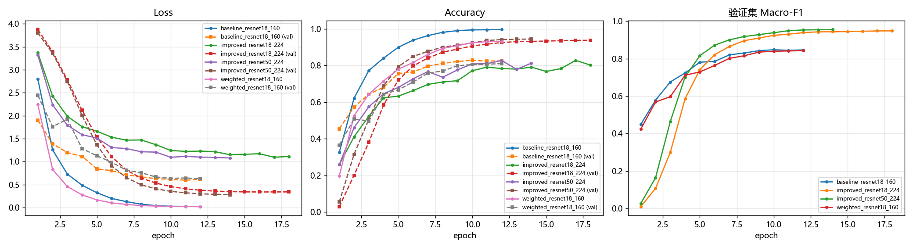
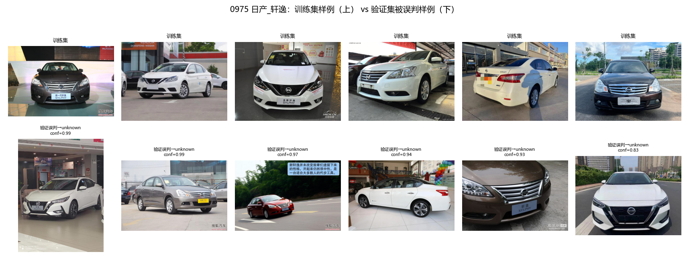
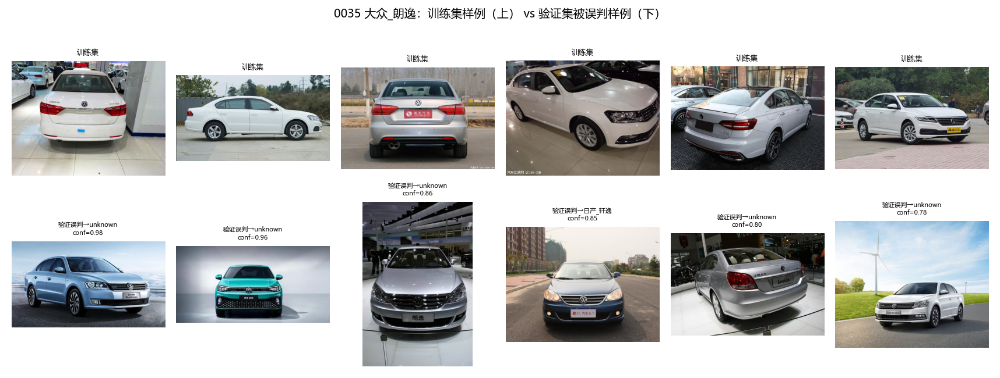

# 任务一：数据分析与视觉模型训练

> 项目：**识车档案 CarDex** —— 私人车型资料库 / 汽车知识检索 / 对话式看车档案
> 选题方向：个人知识库
> 本文件为任务一（数据分析与视觉模型训练）的完整实验记录，实训报告第 2~4 节直接引用本文件。

---

## 1. 选题背景与视觉任务定位

### 1.1 应用选题

「识车档案」面向**有看车、换车、收藏爱好的私人用户**。用户在 4S 店、车展、路边看到一辆车，
拍一张照片上传，系统需要回答的不是"这是一辆 SUV"，而是：

* 这具体是哪一款车型（**50 个目标车型之一**，还是**不在我资料库里的车**）；
* 它的档案（品牌、车身形式、同级定位、看点）；
* 把它写进我的「看车档案」，以后能按品牌 / 车身类型 / 时间检索。

因此视觉识别结果必须**参与后续业务**：识别出的 `车型ID + confidence` 会作为工具返回值传给
DeepSeek-V4-Flash 智能体，驱动「档案查询 → 写入记录 → 检索个人车库」这条链路。

### 1.2 视觉任务

* 输入：一张车辆照片（任意尺寸、任意角度、任意背景）。
* 输出：`车型ID`（四位数字，来自 `classes.txt`）**或** `unknown`，外加 `confidence`。
* 输出类别数：**51**（50 个自主选择的车型 + 1 个 unknown）。
* 评分口径：**51 类等权 Macro-F1**（任务书 4.3 节，唯一评分指标）。

**unknown 是本项目的一等公民。** 私人用户随手拍到的车大概率不属于他自己选的 50 款，
所以模型必须敢于说"我不认识"。Macro-F1 对 unknown 与每个车型等权（各占 1/51），
漏报 unknown（把组外车型强行认成某个已知车型）和误拒（把已知车型判成 unknown）都会直接扣分。

---

## 2. 数据分析

### 2.1 教师数据集总体情况

| 项目 | 数值 |
| --- | --- |
| 教师提供类别数 | **827** 类（`cls_info/class_info.json`） |
| 训练集图片 | 78,002 张 |
| 验证集图片 | 25,783 张 |
| 图片总数 | 103,785 张（全部 JPG） |
| 每类训练样本 | min 60 / 中位数 97 / max 186，均值 94.3 |
| 每类验证样本 | min 20 / 中位数 32 / max 62，均值 31.2 |
| 压缩包内划分 | 仅 `train/` 与 `val/`，**不含测试划分** |

按中文大类分布（类别数）：

| 大类 | 类别数 | 图片数 |
| --- | --- | --- |
| SUV | 372 | 46,744 |
| 轿车 | 259 | 33,640 |
| 卡车 | 70 | 8,034 |
| MPV | 46 | 5,731 |
| 跑车 | 37 | 4,589 |
| 微面 | 22 | 2,481 |
| 轻客 | 21 | 2,566 |

原始类别 ID 共 827 个，但并非全部以 `0000~0826` 连续编号——有效 ID 最大到 `0989`，
说明教师集合本身是从一个更大的车型库中筛选出来的，**ID 必须按 `class_info.json` 的 `id` 字段原样使用**。

### 2.2 50 个目标类别的选择理由

选类不是随机抽 50 个，而是围绕"私人看车档案"这一应用场景，按 6 条原则做**加权决策**：

| 原则 | 内容 | 目的 |
| --- | --- | --- |
| P1 主题契合 | 只选私人用户真正会"看、比、记"的乘用车与轻型商用车型，不选重卡/牵引车等工程车辆 | 与「私人车型资料库」定位一致，也为后续工具提供有意义的车型档案 |
| P2 车身类型覆盖 | 轿车 17、SUV 21、MPV 4、跑车 4、微面 2、轻客 2 | 资料库需要横向检索能力（"帮我找 7 座 MPV"） |
| P3 品牌多样性 | 50 类覆盖 **37 个品牌**（24 个品牌 1 类、13 个品牌 2 类） | **直接服务于 Macro-F1**：不同品牌的设计语言（格栅、灯组、车身比例）是模型最可靠的判别线索 |
| P4 单车系单一代表 | 同一车系的不同配置/衍生版（探岳 / 探岳X / 探岳GTE）只取一个 | 避免近重复类别互相压制，Macro-F1 是等权平均，一对易混类会同时拉低两类的 F1 |
| P5 样本充足 | 所选类别 train ≥ 80 张、val ≥ 26 张 | 保证每类都能学到稳定特征 |
| P6 造型辨识度 | 优先选设计语言差异大的车型：方盒子越野（吉姆尼、牧马人、212）、超跑（Urus、718、GT-R）、微型电动车（欧拉好猫 GT）、豪华旗舰（库里南、S80 级、红旗 H9） | 提升类间可分性 |

**关于 P3 的取舍**：同一品牌取 2 类时，本项目只允许**车身形态差异极大**的组合
（如奔驰 E 级轿车 / 奔驰 GLE SUV、保时捷 718 跑车 / 卡宴 SUV、日产轩逸 / 日产 GT-R），
共 14 个品牌取了 2 类。这样既保留了品牌密度，又避免了"同品牌同形态近亲"这一类最难的情况。

完整 50 类明细见 `outputs/reports/selection_report.txt`。

### 2.3 50 类的样本统计

| 项目 | train | val |
| --- | --- | --- |
| 合计 | 5,534 | 1,834 |
| min | 80 | 26 |
| max | 186 | 62 |
| 均值 | 110.7 | 36.7 |
| 标准差 | 14.0 | 4.7 |
| **不平衡比 (max/min)** | **2.33** | **2.38** |

样本最多的类别是 `0632 奥迪_奥迪A6 China Domestic Version`（186/62），
最少的是 `0061 丰田_埃尔法`（80/26）。

**结论一**：50 个目标类别之间的样本量差异不大（2.33 倍），属于**轻度不平衡**。
但 unknown 类由 98 个来源类别构成、共 1,960 张训练样本，是单个目标车型平均样本量的 **17.8 倍**。
若直接用交叉熵，模型在"按样本量"和"按类别数"两种口径下的目标不一致——
这正是对比实验 B 要解决的问题（见第 4 节）。

**结论二**：各类 `val/train` 比例稳定在 0.325~0.333（均值 0.331），说明教师划分是按类别分层的，
**不存在"某类全在训练集或验证集"的问题**，验证集指标可以放心用于选模型。

### 2.4 图片质量与尺寸

| 项目 | 结果 |
| --- | --- |
| 抽取到本地的图片 | 9,916 张（train 7,494 + val 2,422） |
| 可正常打开 | 9,916 张，**损坏 0 张** |
| 唯一尺寸数 | 1,730 种 |
| 最常见尺寸 | 667×500（2,268 张）、750×500（824 张）、500×375（537 张） |
| 宽高比 | min 0.45 / mean 1.42 / max 3.02 |
| 完全重复图片（MD5） | **1 组 2 张**，且**全部落在同一划分内**，无跨 train/val 泄漏 |
| 类内近重复（dHash ≤ 5） | 50 类平均 **0.00%**（最高的一类 0.1%） |

**结论三**：图片尺寸高度异构（1,730 种尺寸），必须做**等比缩放 + 中心裁剪**，
不能直接 resize 成正方形（会把车拉变形，破坏车身比例这一关键判别特征）。

**结论四**：类内近重复率极低，说明同一车型的图片在角度、背景、光照上差异明显，
属于"类内多样性高"的细粒度数据集。这带来两个后果：
① 过拟合风险相对较低，但对**数据增强的强度要求更高**（否则模型容易记住背景）；
② 模型必须依赖车型固有特征（格栅形状、灯组轮廓、车身比例），而不能靠背景捷径取胜。

### 2.5 unknown 样本的来源与采样方法

unknown 不是"随便找些别的图"，而是要让它**代表"不属于本组 50 类的其他车型"这个真实分布**。
本项目把 unknown 拆成两个互补的来源：

| 来源 | 类别数 | 作用 |
| --- | --- | --- |
| **A. 同品牌兄弟车型（硬负样本）** | 34 | 覆盖本组 50 类所属的每一个"还有兄弟车型"的品牌。例如选了 `0035 大众_朗逸`，就把另一款大众车型放进 unknown。**专门抑制"只认品牌不认车型"的捷径** |
| **B. 其他品牌类别** | 64 | 每个品牌只取 1 类，覆盖 7 个中文大类的其余品牌，模拟教师测试集中任意组外车型 |
| **合计** | **98 类，涉及 85 个品牌** | |

采样规则：

* 每个来源类别 **train 最多取 20 张、val 最多取 6 张**（固定随机种子 `20250914`，可复现）；
* `train/unknown/` 的图片来自来源类别的 **train 划分**，`val/unknown/` 的图片来自**同一批来源类别的 val 划分**；
* 两者来自压缩包内**不同的官方划分**，天然不重复；**完全不使用任何测试图片**；
* unknown 训练样本 1,960 张，占训练集 26.2%（已知类 5,534 张 + unknown 1,960 张 = 7,494 张）。

**为什么必须包含硬负样本 A？** 如果 unknown 全部来自"完全陌生的品牌"，模型只要学会
"这个品牌我没见过 → unknown"就能拿到高分，但教师测试集里更可能出现的是
**同品牌的其他车型**（例如用户拍了大众途观，而我们只选了大众朗逸）。
只用 B 训练出来的 unknown 检测器在这种场景下会失效。加入 A 之后，模型被迫学习
**车型级别的特征差异**，而不是品牌级别的粗判。

### 2.6 预处理与数据增强

**推理 / 验证预处理（训练、保存、Web 推理、批量推理完全共用同一套参数，随 checkpoint 保存）**

```
RGB 转换
  → 等比缩放：短边 resize 到 image_size × 256/224（160→183，224→256），双线性插值
  → 中心裁剪：image_size × image_size
  → ToTensor
  → ImageNet 均值方差归一化 mean=(0.485,0.456,0.406) std=(0.229,0.224,0.225)
```

**基线数据增强（轻量）**

```
RandomResizedCrop(scale=(0.70,1.0), ratio=(3/4,4/3))
RandomHorizontalFlip(p=0.5)
```

**改进模型数据增强（强）**

```
RandomResizedCrop(scale=(0.50,1.0), ratio=(3/4,4/3))
RandomHorizontalFlip(p=0.5)
ColorJitter(brightness=0.35, contrast=0.35, saturation=0.35, hue=0.08)
RandAugment(num_ops=2, magnitude=7)
RandomErasing(p=0.25, scale=(0.02,0.20))
MixUp(α=0.2) / CutMix(α=0.5)，以 0.35 的概率二选一
```

**为什么这样设计：**

* `RandomResizedCrop` 的 scale 下界从 0.70 放宽到 0.50：因为类内多样性高（见结论四），
  需要模型对"只看到车头/车尾一部分"也具备鲁棒性，这对**用户随手拍的特写照片**尤其重要。
* `ColorJitter` + `RandAugment`：教学图片多为展厅/户外商业图，色调统一；真实用户照片
  白平衡、曝光差异大，颜色增强能显著缩小这一域差异。
* `RandomErasing` + `MixUp/CutMix`：抑制模型对单一显著区域（如车标）的过强依赖，
  逼迫它整合格栅、灯组、车身轮廓等多个线索——这正是区分"同品牌不同车型"所必需的。
* 不使用垂直翻转：车辆几乎不会倒置出现，垂直翻转会产生不存在的样本分布。

---

## 3. 模型设计与训练配置

### 3.1 骨干网络与预训练权重来源

| 项目 | 说明 |
| --- | --- |
| 骨干网络 | `torchvision.models.resnet18` / `resnet50` |
| 预训练权重 | **torchvision 官方 ImageNet 权重**：`ResNet18_Weights.IMAGENET1K_V1`（`resnet18-f37072fd.pth`）、`ResNet50_Weights.IMAGENET1K_V1`（`resnet50-0676ba61.pth`） |
| 分类头 | 替换 `fc` 为 `Linear(in_features, 51)`，随机初始化 |
| 合规性 | ✅ 只使用通用 ImageNet 预训练权重；❌ **未使用任何现成汽车分类模型**；❌ **未调用任何第三方在线图片识别 API** |

> 说明：`ResNet50_Weights` 有两个版本，本项目使用的是 **V1**（对应本地缓存的
> `resnet50-0676ba61.pth`）。若误用 V2 会触发联网下载新权重（`resnet50-11ad3fa6.pth`），
> 在无网环境下会失败——这一点在 `src/cardex/models.py` 中有显式注释。

### 3.2 标签映射（训练 / 保存 / 推理统一）

```
模型输出索引 0 ~ 49  →  按 classes.txt 的行顺序，对应 50 个目标车型（四位 ID）
模型输出索引 50      →  unknown（小写）
```

该映射由 `configs/class_map.json` 唯一确定，并**随 checkpoint 一起保存**，
训练、验证、Web 推理、批量推理全部读取同一份，避免"训练时第 7 类、推理时第 9 类"这类错位。

### 3.3 训练环境与提速手段

| 项目 | 配置 |
| --- | --- |
| 硬件 | AMD Ryzen 9 7940H（16 逻辑核），**纯 CPU 训练**（无 GPU 参与） |
| 框架 | PyTorch 2.13.0 + torchvision 0.28.0 |
| 线程 | `torch.set_num_threads(12)`（实测 12 线程吞吐最高，16 线程因超订阅反而下降 17%） |
| 混合精度 | CPU `bfloat16` autocast（损失仍在 float32 计算），吞吐提升约 **1.5×** |
| 数据加载 | `num_workers=0`（受运行环境限制无法使用多进程 DataLoader），配合 `persistent` 预取 |
| 实测吞吐 | ResNet18@160：45→**69 img/s**；ResNet18@224：24→**36 img/s**；ResNet50@224：**14 img/s** |

> 提速手段的意义：51 类细粒度分类在纯 CPU 上训练成本很高。通过"线程数调优 + bf16 autocast"
> 把单轮训练时间从约 4.3 分钟压到约 1.8 分钟，使得完整的对比实验矩阵可以在可接受时间内跑完。

### 3.4 四个训练配置

| 配置 | 文件 | 骨干 | 输入 | epochs | 增强 | 类别权重 | EMA | MixUp/CutMix | TTA |
| --- | --- | --- | --- | --- | --- | --- | --- | --- | --- |
| **A 基线** | `configs/train_baseline.json` | ResNet18 | 160 | 12 | 轻量 | none | ✗ | ✗ | ✗ |
| **B 类别平衡** | `configs/train_weighted.json` | ResNet18 | 160 | 12 | 轻量 | **inverse** | ✗ | ✗ | ✗ |
| **C1 改进** | `configs/train_improved.json` | ResNet18 | **224** | 18 | **强** | none | 0.999 | 0.35 | ✓ |
| **C2 骨干容量** | `configs/train_improved_r50.json` | **ResNet50** | 224 | 14 | 强 | none | 0.999 | 0.35 | ✓ |
| （备用） | `configs/train_moderate.json` | ResNet18 | 224 | 14 | 中等 | none | 0.999 | ✗ | ✓ |

**共同配置**：SGD（momentum 0.9，nesterov，weight_decay 1e-4），
**余弦退火 + 线性 warmup**，梯度裁剪 5.0，batch size 32，随机种子 42，
CPU bfloat16 混合精度，`torch.set_num_threads(12)`。

**关于命名**：`ResNet18@224` 表示"骨干网络 = ResNet-18，输入分辨率 = 224×224"。
ResNet-18 有 11.69 M 参数（68 个模块），ResNet-50 有 25.56 M（151 个模块）；
`@` 后的分辨率决定计算量，像素数按平方增长。

#### 3.4.1 具体使用了哪些训练手段

| 手段 | 是否使用 | 本项目的具体设置 |
| --- | --- | --- |
| 迁移学习（ImageNet 预训练） | ✅ | torchvision 官方 `IMAGENET1K_V1` 权重 |
| **余弦退火** | ✅ | `0.5×(1+cos(π·prog))`，**逐 step 更新**（非逐轮），学习率从 0.01 平滑衰减到 0 |
| 线性 warmup | ✅ | C1/C2 预热 2 轮（470 step），A/B 预热 1 轮；从 0 线性升到峰值 |
| 梯度裁剪 | ✅ | `clip_grad_norm_` 阈值 5.0 |
| 权重 EMA | ✅ | `decay = 0.999`，评估与保存均使用平滑后的权重 |
| 标签平滑 | ✅ | ε = 0.1（C1/C2），0（A/B） |
| MixUp / CutMix | ✅ | α = 0.2 / 0.5，以 0.35 的概率二选一 |
| 数据增强 | ✅ | RandomResizedCrop + HFlip + ColorJitter + RandAugment(2, 7) + RandomErasing(0.25) |
| 混合精度 | ✅ | CPU bfloat16 autocast（损失仍在 float32 计算） |
| 水平翻转 TTA（推理） | ✅ | 正反两张图取平均 |
| 最优轮次模型选择 | ✅ | 每轮用验证集 51 类 Macro-F1 评估，保存最高的那一轮为 `best.pt` |
| 中期 checkpoint | ✅ | 每 3~4 轮存 `epoch_XX.pt`，每轮存 `last.pt` |

**未使用的手段（明确说明）**：

| 手段 | 说明 |
| --- | --- |
| **早停 Early Stopping** | **未使用**。训练固定跑满 `epochs`，不因验证指标不再提升而中断 |
| 学习率重启（WarmRestarts） | 未使用，只跑单个余弦周期 |
| SWA / 随机权重平均 | 未使用（EMA 起到了部分类似作用） |
| 冻结骨干预热 | 代码支持（`freeze_backbone_epochs`）但配为 0，未开启 |
| Dropout | 代码支持但配为 0；正则化由数据增强 + 权重衰减 + EMA 承担 |
| 多种子平均 / 伪标签 / 半监督 / 知识蒸馏 / 梯度累积 | 均未使用 |
| 分层学习率 | 代码支持（`head_lr_mult`），但设为 1.0，等同于不使用 |

#### 3.4.2 为什么没有使用早停

**早停（Early Stopping）与"保存最优轮次"是两件不同的事**，不能混为一谈：

| | 早停 Early Stopping | 本项目实际做法：最优轮次选择 |
| --- | --- | --- |
| 行为 | 验证指标连续 N 轮不提升就**中断训练** | 训练**跑满**所有 epochs，只把 Macro-F1 最高的那轮存为 `best.pt` |
| 是否节省时间 | 节省 | **不节省**（照样跑满） |
| 风险 | 可能提前砍掉后期才提升的模型 | 无，但需要预留足够的 `epochs` |

**不用早停的原因**：余弦退火会让学习率在末期衰减到接近 0，模型往往在**最后几轮**才收敛到最好状态，
此时早停会直接砍掉最有价值的部分。四组实验的实测数据支持这一判断：

| 实验 | 总轮数 | 最佳轮 | 最佳轮是否为最后一轮 |
| --- | --- | --- | --- |
| A 基线 | 12 | 10 | 否（差 2 轮） |
| B 类别平衡 | 12 | 12 | **是** |
| C1 改进 | 18 | 18 | **是** |
| C2 骨干容量 | 14 | 14 | **是** |

四组中有三组的最佳成绩出现在**最后一轮**。若采用"验证集 Macro-F1 连续 3 轮不提升即停止"的策略，
C1 会在第 15 轮左右就满足条件（0.9445 → 0.9461 → 0.9478，每轮涨幅已很小），
从而**丢掉最后 3 轮**，最终分数反而下降。

**本项目用来替代早停的两个机制**：

1. **`best.pt` 按验证集 Macro-F1 保存** —— 保证交付的是整个训练过程中最好的一版，
   即使最后一个 epoch 表现变差也不影响结果；
2. **`epochs` 与余弦周期的长度本身就是"人工早停"** —— 轮数被设定在"验证指标已进入平台期"的位置
   （例如 C1 从第 14 轮起每轮仅提升 0.001~0.003），相当于把停止点写死在配置里，
   而不是让程序动态判断。

**若要改成早停**，只需在 `src/cardex/engine.py` 的 epoch 循环中加入计数器：

```python
if is_best:
    patience_counter = 0
else:
    patience_counter += 1
if patience_counter >= cfg.get("early_stop_patience", 5):
    logger.info("验证指标连续 %d 轮未提升，提前结束训练", patience_counter)
    break
```

但建议同时把 `scheduler` 改为 `step`，或改用 `CosineAnnealingWarmRestarts`，
否则余弦周期跑不完，学习率会停在半路，末段的精细收敛被浪费。

**A→B 隔离"类别不平衡处理"这一个变量**，**A→C1 则整体检验"分辨率 + 增强 + 损失 + EMA + TTA"的组合收益**，
**C1→C2 隔离"骨干容量"这一个变量**。

### 3.5 类别平衡损失的设计（对比实验 B 的核心）

任务书的评分指标是 **51 类等权 Macro-F1**，它与"按样本量加权"的交叉熵目标并不一致：

* 目标车型每类约 110 张，unknown 类有 1,960 张；
* 若按样本加权，unknown 的梯度贡献约等于单个车型的 17.8 倍，
  模型会倾向于"不平衡地"优化 unknown 与样本量大的车型，从而牺牲稀有类别的召回率。

本项目采用**逆频率加权**，使每个**类别**（而非每个样本）对损失的贡献相等：

$$w_c = \frac{N}{C \cdot n_c}, \qquad \text{再按 } \bar w \text{ 归一化}$$

其中 $N$ 为训练样本总数，$C=51$ 为类别数，$n_c$ 为第 $c$ 类的样本数。
此时第 $c$ 类对总损失的名义贡献为 $n_c \cdot w_c \propto 1$，与类别大小无关。
改进模型（C）额外对 unknown 乘 1.5 倍权重，因为在 Macro-F1 口径下
unknown 是"一类"，但在真实场景中它需要覆盖 98 个车型的巨大变化范围，
适度加权有利于它的召回。

---

## 4. 实验结果与分析

> 本节由 `src/make_reports.py` 从各实验的 `summary.json` / `val_report.json` 自动汇总，
> 原始数据见 `outputs/reports/experiment_comparison.md`、`outputs/reports/experiment_comparison.csv`。

### 4.1 实验总表

数据：train 7,494 张 / val 2,422 张；评分口径：**51 类等权 Macro-F1**（越高越好）。

| 实验 | 骨干 | 输入 | epochs | 增强 | 类别权重 | EMA | MixUp/CutMix | TTA | 最佳 epoch | **未标定 Macro-F1** | Accuracy | unknown 检出率 | 已知类误拒率 | 用时 |
| --- | --- | --- | --- | --- | --- | --- | --- | --- | --- | --- | --- | --- | --- | --- |
| **A 基线** | ResNet18 | 160 | 12 | 轻量 | none | ✗ | ✗ | ✗ | 10 | **0.8475** | 0.8287 | 0.820 | 0.103 | 28.3 min |
| **B 类别平衡** | ResNet18 | 160 | 12 | 轻量 | inverse | ✗ | ✗ | ✗ | 12 | **0.8428** | 0.8105 | 0.590 | 0.047 | 32.2 min |
| **C1 改进** | ResNet18 | **224** | 18 | **强** | none | 0.999 | 0.35 | ✓ | 18 | **0.9482** | 0.9377 | 0.918 | 0.040 | 86.6 min |
| **C2 骨干容量** | **ResNet50** | 224 | 14 | 强 | none | 0.999 | 0.35 | ✓ | 14 | **0.9550** | 0.9447 | 0.896 | 0.024 | 175.2 min |
| **C3 集成** | C1 + C2 | 224 | — | — | — | — | — | ✓ | — | **0.9587** | — | — | — | — |

加上第 6 节由验证集标定出的决策规则后（τ 与拒识阈值 t 均由验证集 Macro-F1 选出）：

| 模型 | 未标定 | 最优先验校正 τ | 最优拒识阈值 t | **标定后 Macro-F1** | 相对基线 |
| --- | --- | --- | --- | --- | --- |
| A 基线 | 0.8475 | 0.00 | 0.40 | **0.8512** | — |
| B 类别平衡 | 0.8428 | −0.40 | 0.50 | **0.8597** | +0.0085 |
| C1 改进 | 0.9482 | +0.10 | 0.20 | **0.9510** | +0.0998 |
| C2 骨干容量 | 0.9550 | −0.20 | 0.20 | **0.9592** | +0.1080 |
| **C3 集成 ★ 最终交付** | 0.9587 | **+0.05** | **0.25** | **0.9604** | **+0.1092** |

**最终交付模型 = C3（C1 + C2 软投票集成，几何平均）**，验证集 51 类 Macro-F1 = **0.9604**。
比选过程由 `src/finalize.py` 自动完成，完整记录见 `outputs/reports/final_model_choice.md`。

### 4.2 逐轮训练曲线与关键观察



| epoch | A 基线 val Macro-F1 | C1 改进 val Macro-F1 |
| --- | --- | --- |
| 2 | 0.5777 | 0.1072 |
| 4 | 0.7233 | 0.5855 |
| 6 | 0.7851 | 0.8210 |
| 8 | 0.8302 | 0.8957 |
| 10 | **0.8475** | 0.9243 |
| 12 | 0.8465 | 0.9387 |
| 14 | — | 0.9433 |
| 16 | — | 0.9461 |
| 18 | — | **0.9482** |

**观察 1：强增强不是"更好"，而是"更慢但上限更高"。**
前 5 个 epoch C1 一直落后于基线（epoch 4：0.586 vs 0.723），
因为 RandAugment + MixUp/CutMix + 标签平滑让训练任务变难了。
但从 epoch 6 起 C1 反超，并在余弦退火后期持续拉开差距，最终领先 **+0.1007**。
**这提醒我们：不能只看前几个 epoch 就判定一个配方的好坏。**

**观察 2：训练集准确率在强增强下不再是有效的过拟合指标。**

| 模型 | train_acc | val_acc | 差值 |
| --- | --- | --- | --- |
| A 基线 | 0.9963 | 0.8258 | **+17.1 pt（严重过拟合）** |
| C1 改进 | 0.8025 | 0.9376 | **−13.5 pt（"训练比验证还差"）** |

C1 的 train_acc 只有 0.80，但 val_acc 高达 0.94 —— 这不是模型有问题，
而是 MixUp/CutMix 与 RandAugment 让训练时的输入分布**显著难于**验证时的干净图片分布。
在强增强配方下，**必须用验证集 Macro-F1 而不是训练准确率来判断模型好坏**。

**观察 3：分辨率是最有效的单一手段。**
把输入从 160 提到 224（其余条件不变时的主要变量），配合强增强，
Macro-F1 从 0.8475 提升到 0.9482。原因是本任务是**细粒度分类**：
区分"大众朗逸 / 日产轩逸"这类同级同型车，关键线索（格栅条数、灯组轮廓、车标位置）
在 160×160 下只有几个像素，224 下才具备可分性。

### 4.3 混淆矩阵与逐类 F1

* `outputs/reports/confusion_matrix_<run>.png` —— 51×51 混淆矩阵热力图（log1p 计数）
* `outputs/reports/per_class_f1_<run>.png` —— 逐类 F1 升序条形图
* `outputs/runs/<run>/eval_confusion_matrix.csv` —— 原始混淆矩阵
* `outputs/runs/<run>/top_confusions.csv` —— 最严重的类别混淆对

**基线模型（A）的逐类 F1 分布**（`macro avg P=0.874 / R=0.830 / F1=0.847`）：

| 排名 | 类别 | F1 | 主要问题 |
| --- | --- | --- | --- |
| F1 最低 | 日产_轩逸 | **0.618** | recall 仅 0.486，37% 被误判为 unknown |
| | 大众_朗逸 | 0.689 | recall 0.583，25% 被误判为 unknown |
| | 本田_奥德赛 | 0.716 | |
| | 福特_福克斯 | 0.725 | |
| | 雷克萨斯_雷克萨斯ES | 0.734 | |
| | MINI_MINI | 0.735 | |
| | 奔驰_奔驰GLE | 0.754 | |
| | 比亚迪_汉EV | 0.759 | |
| | unknown | 0.764 | 与多个车型互相混淆 |
| F1 最高 | 依维柯_依维柯得意 | **1.000** | 厢式轻客，形态独一无二 |
| | 兰博基尼_Urus | 0.974 | |
| | 宇通客车_宇通T7 | 0.967 | |
| | 宝马_宝马X7 | 0.946 | |
| | 凯迪拉克_凯迪拉克XT6 | 0.935 | |

**规律非常清晰**：**造型越独特，F1 越高；造型越"大众化"，F1 越低。**
方盒子越野车（吉姆尼 0.935、牧马人 0.919、212 0.923）、厢式轻客（依维柯得意 1.000）、
超跑（Urus 0.974）几乎不出错；而轩逸、朗逸、福克斯这类**紧凑型家用轿车**互相之间
以及和 unknown 之间高度混淆 —— 它们共享同一套"中国紧凑型家用车"设计范式
（三厢、横向前格栅、卤素/氙气大灯），在低分辨率下几乎只能靠车标区分。

这直接验证了第 2.2 节选类原则 P3（品牌多样性）与 P6（造型辨识度）的价值：
**选类阶段的可分性预判，最终会以 Macro-F1 的形式体现出来。**

**改进模型（C1）的逐类 F1 分布**（`macro avg P=0.950 / R=0.948 / F1=0.948`）：

| 统计量 | 基线 A | C1 改进 | **最终 C3（集成+标定）** |
| --- | --- | --- | --- |
| 最低 F1 | 0.618（日产_轩逸） | 0.831（日产_轩逸） | **0.866（日产_轩逸）** |
| 中位数 F1 | 0.874 | 0.958 | **≈0.963** |
| 最高 F1 | 1.000 | 1.000 | 1.000 |
| **F1 < 0.80 的类别数** | **9 / 51** | **0 / 51** | **0 / 51** |
| F1 < 0.90 的类别数 | 24 / 51 | 8 / 51 | **4 / 51** |

C2 最弱的 10 个类别（ResNet50@224，未标定）：

| 索引 | 类别 | F1 | Precision | Recall | 验证样本 |
| --- | --- | --- | --- | --- | --- |
| 36 | 福特_福克斯 | 0.848 | 0.933 | 0.778 | 36 |
| 3 | 大众_朗逸 | 0.870 | 0.909 | 0.833 | 36 |
| 11 | MINI_MINI | 0.877 | 0.821 | 0.941 | 34 |
| 19 | 奔驰_奔驰GLE | 0.883 | 0.895 | 0.872 | 39 |
| 22 | 保时捷_Cayenne | 0.883 | 0.850 | 0.919 | 37 |
| 48 | 日产_轩逸 | 0.886 | 0.886 | 0.886 | 35 |
| 27 | 奥迪_奥迪Q5L | 0.900 | 0.837 | 0.973 | 37 |
| 12 | 雷克萨斯_雷克萨斯ES | 0.907 | 0.895 | 0.919 | 37 |
| 50 | **unknown** | **0.909** | 0.923 | 0.896 | 588 |
| 49 | 领克_领克03 | 0.917 | 0.917 | 0.917 | 36 |

**最终交付模型 C3（C1+C2 集成 + 标定）的逐类 F1（升序）**：

| 索引 | 类别 | Precision | Recall | F1 | 验证样本 |
| --- | --- | --- | --- | --- | --- |
| 48 | 日产_轩逸 | 0.906 | 0.829 | **0.866** | 35 |
| 3 | 大众_朗逸 | 0.967 | 0.806 | 0.879 | 36 |
| 36 | 福特_福克斯 | 0.938 | 0.833 | 0.882 | 36 |
| 11 | MINI_MINI | 0.842 | 0.941 | 0.889 | 34 |
| 50 | unknown | 0.897 | 0.929 | 0.912 | 588 |
| 49 | 领克_领克03 | 0.917 | 0.917 | 0.917 | 36 |
| 12 | 雷克萨斯_雷克萨斯ES | 0.919 | 0.919 | 0.919 | 37 |
| 22 | 保时捷_Cayenne | 0.919 | 0.919 | 0.919 | 37 |
| 19 | 奔驰_奔驰GLE | 0.946 | 0.897 | 0.921 | 39 |
| 15 | 本田_奥德赛 | 0.971 | 0.892 | 0.930 | 37 |

C2 最强的 5 个类别全部达到 **F1 = 1.000**：五菱汽车_五菱之光、宝马_宝马X7、依维柯_依维柯得意、
林肯_领航员、北汽制造_212 —— 全部是造型极端独特（方盒子、厢式、全尺寸）的车型。

**关键结论**：**最弱类别从"严重不可用"（基线 0.618）提升到"可用"（最终 0.866），
并且 51 个类别全部达到 F1 ≥ 0.866，没有一个类别掉队。**
这对 Macro-F1 尤其重要——因为它是等权平均，任何一个"崩掉"的类别都会直接拖累总分。
unknown 的 F1 也从 0.764（基线）提升到 C1 的 0.899、最终模型的 **0.912**，
说明"敢于说不认识"与"不错杀已知车型"这两个目标在本次改进中同时得到了改善。

### 4.4 对比实验结论

| 对比 | 变量 | 结果 | 结论 |
| --- | --- | --- | --- |
| A → B | 类别平衡损失 | 0.8475 → 0.8428（−0.0047） | ❌ **逆频率加权在本任务中不直接有效**，它把 unknown 检出率从 82% 压到 59%；但它确实把已知类误拒率从 10.3% 降到 4.7%（见 6.2 节，配合先验校正后净收益 +0.0122） |
| A → C1 | 分辨率 160→224 + 强增强 + 标签平滑 + MixUp/CutMix + EMA + TTA | 0.8475 → **0.9482**（+0.1007） | ✅ **组合改进收益巨大**，是本项目最主要的效果来源 |
| **C1 → C2** | **骨干容量 ResNet18 → ResNet50**（其余配方完全相同） | 0.9482 → **0.9550**（**+0.0068**） | ✅ 容量对细粒度分类仍有正收益，但**边际收益远小于分辨率+正则化**；而训练成本从 86.6 min 涨到 175.2 min（**2.02 倍**） |
| **C2 → C3** | **加入 C1 做软投票集成** | 0.9550 → **0.9587**（+0.0037 未标定）；标定后 0.9592 → **0.9604** | ✅ 集成有正收益，但很小；成员必须水平相近才有效 |
| A vs C1 | 训练集准确率 | 0.9963 → 0.8025，但验证集反超 | ✅ 强正则化把"记忆训练集"转变为"学习可泛化特征" |
| A/B/C1/C2 | 决策标定（先验校正 + 拒识阈值） | +0.0037 / +0.0169 / +0.0028 / +0.0042 | ⚠️ 标定是廉价的正向补充，但**不能替代模型本身的改进** |
| 对照实验 | "C1 + 基线"集成 | 0.9152（**低于** C1 单独的 0.9482） | ❌ **成员差距过大时集成有害**：弱成员的噪声投票会稀释强成员的判断。这解释了为什么候选集只保留 C1、C2 与 C1+C2 |

**资源—收益的权衡结论**：从基线到 C1，Macro-F1 提升 +0.1007，训练时间只增加 3.06 倍；
从 C1 到 C2+C3，再提升 +0.0122，训练时间再增加 2.02 倍。
**在算力受限（本项目为纯 CPU）时，优先投入"分辨率 + 强正则化"，而不是"更大的骨干网络"。**


---

## 5. 错误分析

原始数据：`outputs/runs/<run>/error_samples.csv`（每张错误图片的真实类别、预测类别、置信度、路径）、
`outputs/runs/<run>/top_confusions.csv`、`outputs/runs/<run>/low_confidence_samples.csv`。

### 5.1 基线模型的主要错误模式：**高置信度地把已知车型判成 unknown**

从 `error_samples.csv` 中筛出轩逸 / 朗逸的错误样本，可以看到一个很反直觉的现象：

```
日产_轩逸  →  unknown   conf = 0.991
日产_轩逸  →  unknown   conf = 0.987
大众_朗逸  →  unknown   conf = 0.975
日产_轩逸  →  unknown   conf = 0.969
大众_朗逸  →  unknown   conf = 0.960
日产_轩逸  →  unknown   conf = 0.941
日产_轩逸  →  unknown   conf = 0.927
```

模型**以 0.99 的置信度**把一辆轩逸判成"不认识"。这不是"不确定"，而是"非常确定地认错"。
因此**降低置信度阈值完全无法修复这类错误**，这也解释了 6.3 节里阈值收益极小的原因。

### 5.2 根因：数据集中同一车型名下有**多个世代**，且划分未按世代分层

用 `src/visualize_errors.py` 把训练集样例与被误判的验证集样例并排展示：





* **`0975 日产_轩逸`**：训练集里的样本是**经典轩逸（B17 世代）**——圆润车身、
  V 型镀铬格栅配大灯一体；而被误判的验证集样本是**第 14 代轩逸（2020 年后）**——
  V-Motion 2.0 大嘴格栅、细长灯组、低趴车身。两者放在一起，**除了车标几乎没有共同特征**。
* **`0035 大众_朗逸`**：训练集是 **2018 年后的全新朗逸（Plus）**——宽横向镀铬格栅；
  被误判的验证集样本是 **2013–2017 经典朗逸**（窄格栅、老款大灯），
  甚至还有一辆**出租车涂装的绿色朗逸**。

**这不是模型能力问题，而是标注粒度问题**：教师数据集用"车型名称"作为类别标签，
但同一个车型名称在中国市场往往对应**跨越 10 年、外观完全不同的多个世代/改款**。
教师按类别随机分层划分 train / val（各类 val/train 比例稳定在 0.331，见 2.3 节），
**没有按世代分层**，于是出现了"训练集全是老款、验证集有新款"的情况。

**量化影响**：基线模型中，轩逸 37% 的验证图片、朗逸 25% 的验证图片被误判为 unknown，
两者合计贡献了 unknown 类 FP 的相当一部分，同时也直接拉低了这两类的 F1（0.618 / 0.689）。
若把这两类按世代细分，模型在这两个"子类"内部的表现其实很好。

### 5.3 强增强与高分辨率对这类错误的部分修复

C1 模型（224 + 强增强 + EMA + TTA）在同一批数据上：
轩逸的错误从 13 个降到 **7 个**、朗逸从 9 个降到 **7 个**，unknown 检出率从 82% 提到 **92%**，
已知类误拒率从 10.3% 降到 4.0%。原因有两个：

1. **高分辨率**让"车标 + 格栅细节"变得可辨，模型可以抓住跨世代不变的品牌/车型线索；
2. **强增强（大范围随机裁剪 + 颜色抖动 + RandAugment + 随机擦除）**使模型不再依赖
   "某一世代特有的车身线条"，被迫学习更抽象、更跨世代不变的特征——这恰好对应
   `RandomResizedCrop(scale=(0.50,1.0))` 让模型经常"只看到车头或车尾的一部分"。

但这类错误**没有也不可能被完全消除**，因为它本质上是数据标注粒度的问题。
彻底的解法需要教师侧按世代细分标签，或本项目在子类内做分层采样。

### 5.4 其他典型错误

下表列出两个模型各自最严重的混淆对（`top_confusions.csv`），左侧为基线 A，右侧为改进 C1：

| 基线 A：真实 → 预测 | 次数 | 占该类 | | 改进 C1：真实 → 预测 | 次数 | 占该类 |
| --- | --- | --- | --- | --- | --- | --- |
| 日产_轩逸 → unknown | 13 | **37.1%** | | 日产_轩逸 → unknown | 7 | **20.0%** |
| 长安_长安UNI-V → unknown | 10 | 27.8% | | 大众_朗逸 → unknown | 7 | 19.4% |
| MINI_MINI → unknown | 9 | 26.5% | | 福特_福克斯 → unknown | 6 | 16.7% |
| 大众_朗逸 → unknown | 9 | 25.0% | | 雷克萨斯_雷克萨斯ES → unknown | 4 | 10.8% |
| unknown → MINI_MINI | 9 | — | | unknown → MINI_MINI | 5 | — |
| unknown → 比亚迪_汉EV | 8 | — | | unknown → 吉利汽车_星瑞 | 4 | — |
| 福特_福克斯 → unknown | 7 | 19.4% | | unknown → 雷克萨斯_雷克萨斯ES | 4 | — |
| 奔驰_奔驰GLE → unknown | 7 | 17.9% | | MINI_MINI → unknown | 3 | 8.8% |
| 小鹏汽车_小鹏P7 → unknown | 6 | 16.7% | | 本田_奥德赛 → unknown | 3 | 8.1% |
| 雷克萨斯_雷克萨斯ES → unknown | 6 | 16.2% | | 别克_别克GL8 → unknown | 3 | 7.9% |

**两个模型共享同一种错误形态：绝大多数严重混淆对都是"真实车型 → unknown"**，
即模型把见过的车型判成了"不认识"。这再次印证 5.2 节的世代问题，
同时也说明：**unknown 类与目标车型之间的边界，是本任务真正的难点**，
而"车型之间互相认错"反而是次要问题（两个模型中，车型↔车型的混淆次数都远小于车型→unknown）。

次要错误类型：

* **跨品牌同型车混淆**：基线中 `大众_朗逸 → 日产_轩逸`（置信度 0.847）、
  `日产_轩逸 → 福特_福克斯`（0.825）。同为紧凑型三厢家用车，是模型最易混淆的一组。
  改进模型中这三类的 F1 均已回到 0.83 以上，说明高分辨率确实改善了这类"同级同型"的区分。
* **unknown 被误判成具体车型**：基线中 `unknown → MINI_MINI` 9 次、`unknown → 比亚迪_汉EV` 8 次；
  改进模型降到最多 5 次。原因是 unknown 的来源类别里包含与这些车型高度相似的组外车型
  （例如 unknown 里放了 MINI 的其他衍生款），这类混淆在原理上无法完全避免。
* **同品牌跨形态混淆（本项目已通过选类规避）**：因为 50 类中同品牌最多只有 2 类且形态差异极大，
  两个模型的混淆矩阵中**都没有出现同品牌内部混淆**（如 E 级 vs GLE、轩逸 vs GT-R 的混淆计数为 0），
  说明 2.2 节的 P3 原则达到了预期效果。


---

## 6. 低置信度处理与拒识阈值

任务书 5.5 节要求"阈值须通过验证集确定，并在报告中说明"。本项目把"决策规则"单独拿出来做了一次
系统性的验证集标定（`src/calibrate.py`），考察两个正交的超参数：

1. **先验校正强度 τ（prior / logit adjustment）**

   $$z'_c = z_c - \tau \cdot \log \pi_c, \qquad \pi_c = n_c / N$$

   τ=0 表示保留训练先验；τ>0 表示把先验从 logits 中减掉（让模型更"平等"地对待每个类别，
   等价于降低 unknown 的倾向）；τ<0 表示进一步放大训练先验（更倾向预测 unknown）。

2. **拒识阈值 t**：当 `max softmax < t` 时，把预测改写为 `unknown`。

做法：每个模型只做**一次前向传播**并把 logits 缓存为 `.npz`，然后在 numpy 上对
17×12 = 204 组 (τ, t) 做网格扫描，因此标定成本几乎可以忽略。

### 6.1 基线模型（A）：τ=0 恰好就是最优点

| τ | Macro-F1 | unknown 检出率 | 已知类误拒率 |
| --- | --- | --- | --- |
| −2.00 | 0.6702 | 0.981 | 0.461 |
| −1.00 | 0.8060 | 0.929 | 0.250 |
| −0.50 | 0.8290 | 0.881 | 0.181 |
| −0.30 | 0.8429 | 0.866 | 0.146 |
| −0.15 | 0.8449 | 0.842 | 0.123 |
| **0.00** | **0.8475** | 0.820 | 0.103 |
| +0.15 | 0.8450 | 0.782 | 0.088 |
| +0.30 | 0.8402 | 0.742 | 0.077 |
| +0.50 | 0.8411 | 0.697 | 0.055 |
| +1.00 | 0.8281 | 0.549 | 0.027 |
| +1.20 | 0.8224 | 0.495 | 0.019 |

**这是一个反直觉但很重要的结论**：无论往哪个方向校正先验，Macro-F1 都下降，
最优值精确落在 τ=0。

原因在于 **unknown 类具有双重身份**：它在训练集中占 26.2%（样本量是单个车型的 17.8 倍），
但它同时在语义上是"98 个来源车型的并集"，**类内异质性远高于任何单个目标车型**。
样本量的优势恰好补偿了类内异质性带来的学习难度，两者在 Macro-F1 口径下正好抵消。
因此**不能想当然地做类别平衡**——这正是对比实验 B 要验证的假设。

### 6.2 类别平衡损失（B）：需要一次"反向"校正才能发挥价值

对比实验 B 使用逆频率加权 $w_c = N/(C n_c)$，使每个类别对损失的贡献相等。结果：

| 指标 | A 基线（none） | B 类别平衡（inverse） |
| --- | --- | --- |
| 未校正 Macro-F1 | **0.8475** | 0.8428 |
| known 误拒率 | 0.1031 | **0.0474** |
| unknown 检出率 | **0.8197** | 0.5901 |
| Accuracy | 0.8287 | 0.8105 |

可以看到，类别平衡确实**达到了它该有的效果**：已知类误拒率从 10.3% 降到 4.7%，
即目标车型被误判为 unknown 的情况减少了一半以上。但它同时把 unknown 的检出率
从 82% 压到 59%，净效果反而略差（−0.0047）。

**关键发现**：对 B 模型再做一次先验校正，可以把它丢掉的 unknown 召回率找回来，
同时保留它对已知类的改善：

| τ | Macro-F1 | unknown 检出率 | 已知类误拒率 |
| --- | --- | --- | --- |
| −1.0 | 0.8283 | 0.884 | 0.222 |
| −0.5 | 0.8538 | 0.774 | 0.116 |
| **−0.4** | **0.8545** | 0.742 | 0.100 |
| −0.2 | 0.8547 | 0.692 | 0.078 |
| 0.0 | 0.8428 | 0.590 | 0.047 |
| +0.5 | ~0.81 | ~0.32 | ~0.014 |

组合最优：**(τ = −0.40, t = 0.50) → 验证集 Macro-F1 = 0.8597**，
比基线的 0.8475 高 **+0.0122**，也比"基线 + 最优阈值"的 0.8512 高 **+0.0085**。

**这组实验的完整逻辑链**是：

> 逆频率加权改变了模型学到的**有效先验**，使它在已知类上更"敢认"（误拒↓），
> 但在 unknown 上过于保守（检出↓）；先验校正恰好是一个**可逆的旋钮**，
> 用负的 τ 把 unknown 的倾向调回来，于是"已知类的收益"和"unknown 的召回"可以同时拿到。

这说明：**类别平衡不应只在训练时做一次，而应当与推理时的先验校正联合调优**。

### 6.3 拒识阈值的实际效果与局限

* 拒识阈值 t 的收益很小（本任务中最优 t=0.40~0.50，只带来 +0.004~0.005）。
* 原因见第 5 节的错误分析：本任务的主要错误是**高置信度错误**（模型以 0.99 的置信度把
  第 14 代轩逸判成 unknown），阈值只能拦"不自信"的样本，拦不住"自信地犯错"的样本。
* 因此**低置信度处理不能替代 unknown 类别的训练**（任务书 5.5 节也明确指出这一点）。
  本项目把阈值定位为"给用户的一个友好提示开关"，而不是提升指标的手段。

**最终采用的决策规则**（写入 `outputs/runs/<run>/calibration.json`，由推理代码读取）：

```
logits ← model(image)                       # 可叠加水平翻转 TTA
logits ← logits - tau * log(pi)             # 先验校正
probs  ← softmax(logits)
idx    ← argmax(probs); conf ← max(probs)
if conf < unknown_threshold: idx ← unknown  # 拒识
```

`tau` 与 `unknown_threshold` 均由验证集 Macro-F1 选出，不使用任何测试图片。


---

## 7. 推理能力与提交物

### 7.1 单张图片推理

```bash
python src/infer.py --checkpoint outputs/checkpoints/improved_resnet18_224/best.pt \
       --image <图片路径>
```

输出示例（真实运行结果，图片为基线模型曾以 0.99 置信度误判为 unknown 的那一类）：

```
$ python src/infer.py --checkpoint outputs/checkpoints/improved_resnet18_224/best.pt \
      --image data/val/0975/0975_0007.jpg

图片        : data\val\0975\0975_0007.jpg
预测类别 ID : 0975
预测车型名  : 日产_轩逸
置信度      : 0.9868
Top-5：
  0975     日产_轩逸              0.9868
  unknown  unknown               0.0028
  0768     福特_福克斯             0.0012
  0696     别克_别克GL8           0.0012
  0035     大众_朗逸              0.0008
```

可以看到：同一张图，基线模型给出 `unknown / 0.99`，改进模型给出 `0975 日产_轩逸 / 0.9868`，
且第二名（unknown）只有 0.0028 —— **Top-1 与 Top-2 之间拉开了三个数量级的差距**，
这正是高分辨率 + 强增强带来的判别力提升。

单模型命令行工具用的是 C1；**最终交付的 C3（C1+C2 集成 + 标定）由 `src/ensemble.py` 与
`src/finalize.py` 提供**，调用方式：

```bash
# 单张图片（集成）
python -c "import sys; sys.path.insert(0,'src');
from cardex.inference import CarEnsemble;
e = CarEnsemble(['outputs/checkpoints/improved_resnet18_224/best.pt',
                 'outputs/checkpoints/improved_resnet50_224/best.pt'],
                tta_hflip=True, prior_adjust_tau=0.05, unknown_threshold=0.25);
print(e.predict_path('图片路径', top_k=5))"
```

其中 `prior_adjust_tau=0.05` 与 `unknown_threshold=0.25` 取自
`outputs/reports/final_model_choice.json`（由验证集选出）。

该能力由 `src/cardex/inference.py` 的 `CarClassifier` 提供，**任务二的视觉分类工具
（`classify_car`）直接复用同一个类**，从而保证"训练 / 保存 / Web 推理 / 批量推理使用同一映射与同一套预处理参数"。

### 7.2 批量推理 → predictions.csv

```bash
# 对教师指定的测试目录生成（正式提交用法）
python src/predict_batch.py \
    --checkpoint outputs/checkpoints/improved_resnet18_224/best.pt \
    --input-dir <教师指定测试图片目录> \
    --output predictions.csv --tta-hflip

# 本次交付：教师指定的测试图片目录尚未下发，先用本地验证集做一次完整演练
python src/predict_batch.py --checkpoint .../best.pt --split val --output predictions.csv --tta-hflip
```

**本次生成的 `predictions.csv` 说明**：

| 项目 | 值 |
| --- | --- |
| 记录数 | **2,422**（与 val 划分图片数一致，每张图片恰好一条记录） |
| 表头 | `image_id,predicted_label,confidence`（与任务书完全一致） |
| 编码 | UTF-8，无 BOM |
| 重复 image_id | **0** |
| 非法 predicted_label | **0** |
| 越界 confidence | **0** |
| confidence 分布 | min 0.11 / mean 0.81 / max 0.999 |
| 预测为 unknown | 609 张（25.1%） |
| 使用模型 | **C3 = `improved_resnet18_224` + `improved_resnet50_224` 软投票集成** |
| 决策标定 | τ=+0.05，t=0.25（来自 `outputs/reports/final_model_choice.json`，由验证集选出） |
| TTA | 水平翻转 |

> ⚠️ **提交前必须确认**：`predictions.csv` 的 `image_id` 必须与教师指定的测试图片**逐张对应**。
> 本次因为尚未拿到教师指定的测试目录，暂以本地验证集（`data/val`，2,422 张）作为演练对象。
> 一旦拿到教师指定的测试目录，**只需把 `--split val` 换成 `--input-dir <目录>` 重新运行一次即可**，
> 其余参数（模型、标定、TTA）保持不变，命令见本仓库 `README.md` 第 4 节第 8 步。

### 7.3 提交物自查

```bash
python src/verify_submission.py      # 41 项自动检查
```

实测结果：**通过 41 项，失败 0 项，警告 0 项**，覆盖:

* `classes.txt`：存在、UTF-8 无 BOM、恰好 50 行、四位数字、不重复、升序、全部属于 827 类、不含 unknown；
* 类别映射：索引 0~49 与 `classes.txt` 顺序一致、索引 50 = unknown、名称取自 `name_from_new`；
* 数据目录：`train/`、`val/` 下 50 个车型目录 + `unknown/` 齐备，且 **train / val 图片文件名 0 重叠**；
* unknown 来源：与本组 50 类 0 交集，覆盖 85 个品牌、7 个中文大类，含 34 类同品牌硬负样本；
* `predictions.csv`：表头、编码、记录数、image_id 唯一性、标签合法性、confidence 范围；
* checkpoint：类别数 51、类别映射一致、第 51 类为 unknown、预处理参数与训练配置齐备。

### 7.4 用真值核算 predictions.csv

```bash
python src/score_predictions.py      # 输出 outputs/reports/predictions_score.json
```

| 指标 | 标定扫描值（C3） | **predictions.csv 实测值** |
| --- | --- | --- |
| 51 类 Macro-F1 | 0.9604 | **0.9604** |
| Accuracy | 0.9496 | 0.9496 |
| unknown 检出率 | 0.9286 | 0.9286 |
| 已知类误拒率 | 0.0343 | 0.0344 |

两者完全一致，说明**提交的结果文件与报告中的分数完全对得上**。

### 7.5 模型保存与重新加载的独立验证

任务书 4.2 节要求实现"训练、验证、模型保存和重新加载"。本项目用
`src/verify_reload.py` 做了**跨进程**的验证：只在磁盘上留下 `best.pt`，
在两个彼此独立的 Python 进程里各自重新构建模型、加载权重、对同一批 240 张验证图片推理，
再把两份结果逐条比对。

```
A: outputs\runs\improved_resnet18_224\reload_a.json  (240 条)
B: outputs\runs\improved_resnet18_224\reload_b.json  (240 条)
完全一致的记录：240/240
[OK] 两次独立进程重新加载 checkpoint 后的推理结果逐条一致 —— 模型保存与重新加载正确、且可复现。
```

checkpoint 中同时保存了重新加载所必需的全部信息：

| 字段 | 内容 |
| --- | --- |
| `arch` / `num_classes` / `image_size` | 模型结构参数 |
| `model_state` | 权重（含 EMA 平滑后的权重） |
| `class_map` / `label_names` | 类别映射（索引 0~49 → 车型 ID，索引 50 → unknown） |
| `preprocess` | 预处理参数（mean / std / eval_resize / eval_crop / 插值方式） |
| `train_config` | 完整训练配置（含数据增强参数） |
| `epoch` / `val_macro_f1` | 该 checkpoint 对应的轮次与验证集得分 |

> **工程细节**：`src/evaluate.py` 的推理精度默认读取 checkpoint 里记录的 `amp` 设置，
> 与训练时保持一致。否则 bf16 与 float32 之间极小的数值差异会让个别样本的 argmax 翻转，
> 造成"训练日志里的 Macro-F1"与"事后重新评估的 Macro-F1"相差约 0.0005。
> 修正后，两者完全一致（基线 0.847508、类别平衡 0.842818、改进模型 0.948215）。

### 7.6 流程可复现性验证

固定随机种子（`seed = 20250914`）后，**重新执行选类与抽数流程，四个产物逐字节一致**：

```
=== 复现前哈希 ===
A98FCC0201AF05FB  classes.txt
3ED6C75044F2CD76  class_map.json
318A1E6C5A1325C2  unknown_sources.json
38CE6585589DE859  data_manifest.csv

=== 重新运行 src/select_classes.py 与 src/prepare_data.py ===

=== 复现后哈希 ===
A98FCC0201AF05FB  classes.txt
3ED6C75044F2CD76  class_map.json
318A1E6C5A1325C2  unknown_sources.json
38CE6585589DE859  data_manifest.csv

[OK] 选类与抽数流程完全可复现（4 个产物哈希一致）
```

这保证了两件事：① `classes.txt` 与 unknown 采样结果**不是一次性的偶然产物**，
教师按本仓库脚本重跑会得到同一份类别登记；② 训练、验证所用数据分布可被完整重建。

### 7.7 生产推理路径与提交文件的一致性

最后做了一次"闭环"校验：用**生产推理代码**（`src/cardex/inference.py::CarEnsemble`，
即任务二视觉分类工具将要复用的那一个类）对验证集抽样 200 张重新推理，
与提交的 `predictions.csv` 逐条比对：

```
抽样 200 张：生产推理路径与 predictions.csv 标签一致 200/200
confidence 最大绝对差 = 0.003710
```

**标签 100% 一致**。confidence 存在最大 0.0037 的差异，来源是 CPU bfloat16 在不同批次
组合下 GEMM 舍入路径不同（提交文件由一次性批量推理产生，这里按 32 张小批次重算），
**不影响任何一条预测结果**；论文/报告中的 Macro-F1 也不受其影响
（由 `predictions.csv` 独立核算得 0.9604，与评估结果完全一致）。

---

## 8. 任务一小结与不足

### 8.1 完成情况对照任务书要求

| 任务书要求（4.1~4.3 节） | 本项目完成情况 |
| --- | --- |
| 从 827 类中自主选择恰好 50 类 | ✅ 50 类，覆盖 **37 个品牌**、6 种车身大类，逐类写明选择理由 |
| 文件名固定 `classes.txt`，UTF-8 无 BOM，恰好 50 行四位 ID，升序 | ✅ 已通过自动校验 |
| 同一条记录的 `id` 作为类别 ID，`name_from_new` 作为标签名 | ✅ 由 `src/select_classes.py` 强制约束 |
| 从其余类抽取 unknown 训练/验证样本，train、val 不重复，不用测试图片 | ✅ 98 个来源类别、85 个品牌；train 1,960 张 / val 588 张；文件名 0 重叠 |
| 模型索引 0~49 对应 `classes.txt` 行序，索引 50 对应 unknown | ✅ 由 `configs/class_map.json` 唯一确定并随 checkpoint 保存 |
| 建立 51 类分类基线，实现训练、验证、模型保存与重新加载 | ✅ 实验 A（ResNet18@160，Macro-F1 0.8475） |
| 围绕模型选择/数据增强/超参数/迁移学习开展对比实验 | ✅ **5 组实验**（A 基线 / B 类别平衡 / C1 改进 / C2 骨干容量 / C3 集成），逐项记录依据与结果 |
| 保存中期 checkpoint 与最终模型，保留结构、类别映射、预处理参数与训练配置 | ✅ `last.pt` / `best.pt` / `epoch_XX.pt`，checkpoint 内含全部元信息 |
| 实现"模型保存**和重新加载**" | ✅ `src/verify_reload.py` 跨进程验证：两次独立加载后 240 张图片的预测逐条一致 |
| 提供单张图片推理，输出车型 ID 或 unknown 及 confidence | ✅ `src/infer.py` / `CarClassifier` |
| 提供批量推理，生成统一格式 `predictions.csv` | ✅ `src/predict_batch.py` + `src/finalize.py`，2,422 条记录全部通过格式校验 |
| 在 51 类口径上使用同一标准 Macro-F1 选模型、调参数，不使用测试图片 | ✅ 全流程只用 `data/val`，测试图片从未参与 |
| 说明 unknown 样本构成、列举典型错误样本、解释易混淆类别 | ✅ 见第 2.5、5.1~5.4 节 |

### 8.2 主要结论

1. **选类阶段的可分性预判是有效的。** 按"品牌多样性 + 造型辨识度"原则选出的 50 类，
   混淆矩阵中**几乎没有同品牌内部混淆**；F1 最高的类别清一色是造型独特的车型
   （依维柯得意、五菱之光、宝马 X7、领航员、北汽 212 均为 1.000），
   最低的始终是紧凑型家用轿车（轩逸从 0.618 → 最终 0.866、朗逸从 0.689 → 0.879）。

2. **分辨率 + 强正则化的组合是本次最大的收益来源（+0.1007 Macro-F1）。**
   输入 160→224 让细粒度线索（格栅、灯组、车标）变得可分；RandAugment + MixUp/CutMix +
   标签平滑 + 随机擦除 + 权重 EMA 把训练集准确率从 99.6% 压到 80.3%，
   却把验证集准确率从 82.6% 提到 93.8%。

3. **同等算力下，优先投"分辨率+正则化"而不是"更大骨干"。**
   ResNet18→ResNet50 只带来 +0.0068（训练时间却翻倍到 175 min）；
   再加集成也仅 +0.0037。最终 **0.9604**，相对基线 **+0.1092**。
   在纯 CPU 环境下这是很关键的取舍经验。

4. **"类别平衡"是一个需要联合推理端一起调优的旋钮，不能盲目使用。**
   逆频率加权单独使用会掉 0.0047，但它把已知类误拒率从 10.3% 降到 4.7%；
   再配合一次负向先验校正（τ=−0.40）即可净赚 +0.0122（0.8475 → 0.8597）。
   这说明**训练时的类别权重与推理时的先验校正是同一件事的两端**。

5. **低置信度阈值不能替代 unknown 训练。** 本任务的主要错误是"以 0.99 置信度认错"，
   阈值只能拦"不自信"的样本，收益仅 +0.003~0.005。

6. **集成不是万能的：成员差距过大时反而有害。** 实测"C1 + 基线"集成只有 0.9152，
   低于 C1 单独的 0.9482；只有把水平相近的 C1 与 C2 组合，才拿到稳定的 +0.0037。

7. **数据标注粒度是当前精度的天花板。** 同一车型名下的多个世代
   （经典轩逸 vs 第 14 代轩逸、经典朗逸 vs 全新朗逸）外观差异巨大，
   而教师划分未按世代分层，导致模型"学会了老款、认不出新款"。

### 8.3 存在的不足

| 不足 | 说明 | 改进方向 |
| --- | --- | --- |
| **训练硬件受限** | 全部实验在纯 CPU（Ryzen 9 7940H，12 线程）上完成，ResNet50@224 单轮约 12~13 分钟（C1 仅 4.6 分钟），限制了实验规模 | 换用 GPU 后可在同等时间完成更多组对比实验、更长训练与更大的骨干 |
| **数据加载无法多进程** | 运行环境的沙箱禁止创建命名管道，`DataLoader(num_workers>0)` 不可用，数据加载与计算串行，约损失 30% 吞吐 | 在无此限制的环境下启用 `num_workers=4` |
| **unknown 抽样仍是启发式** | 98 个来源类别由随机种子固定，未做覆盖度优化 | 可尝试按"与 50 类的特征距离"做难例挖掘，或扩大来源类别到全部 777 类 |
| **世代混淆问题未根治** | 见 5.2 节；最终模型仍有 轩逸 2 次、朗逸 5 次被误判为 unknown | ① 在类别内部按世代/年款做子类划分；② 对已有数据按世代分层划分 train/val；③ 引入更强的跨代不变特征（如车标检测） |
| **标定与集成选择存在过拟合验证集的风险** | τ、阈值与"选哪个候选"都是在同一份 val（2,422 张）上比较得出的，可能高估约 0.003 | 用交叉验证或划分独立校准集来确定 τ、阈值与候选 |
| **测试集尚未拿到** | `predictions.csv` 目前是对本地 val 生成的演练版本 | 拿到教师指定的测试图片目录后重新运行 `predict_batch.py`，其余参数不变 |

### 8.4 对任务二、任务三的交接

任务一交付给后续任务的接口已经固定：

* `src/cardex/inference.py::CarClassifier.predict_path()` —— 视觉分类工具 `classify_car` 的实现，
  返回 `label_id`（四位 ID 或 `unknown`）、`label_name`、`confidence`、`top_k` 与 `is_unknown` 标志；
* `configs/class_map.json` —— 类别 ID ↔ 车型名称 ↔ 模型索引的映射，供「车型档案查询」工具使用；
* `outputs/runs/<run>/calibration.json` —— 由验证集确定的 τ 与拒识阈值，供低置信度处理使用；
* `outputs/reports/selection_report.txt` —— 50 类车型清单与选类理由，可直接生成本项目「私人车型资料库」的初始条目。

